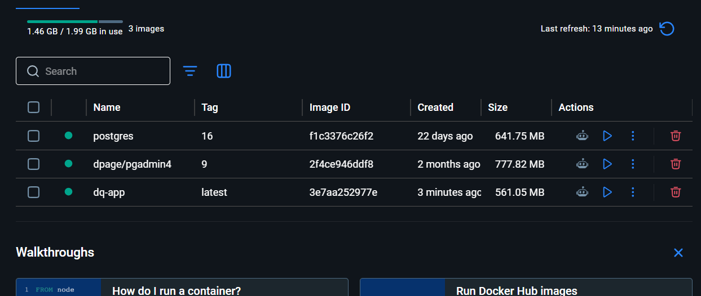
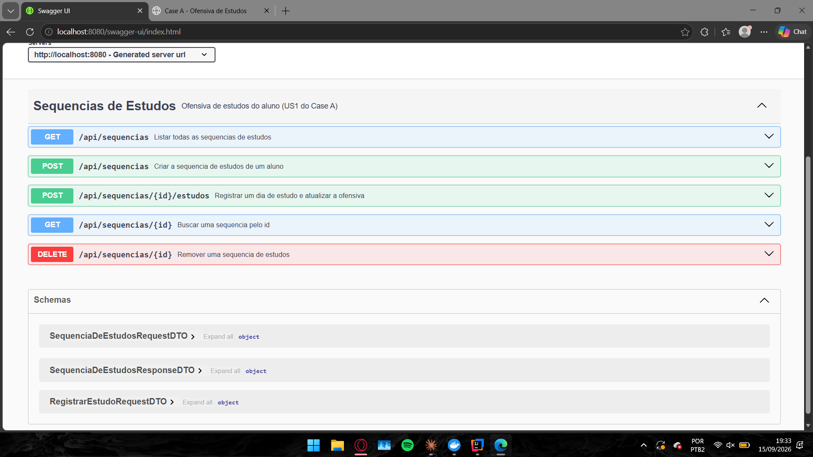
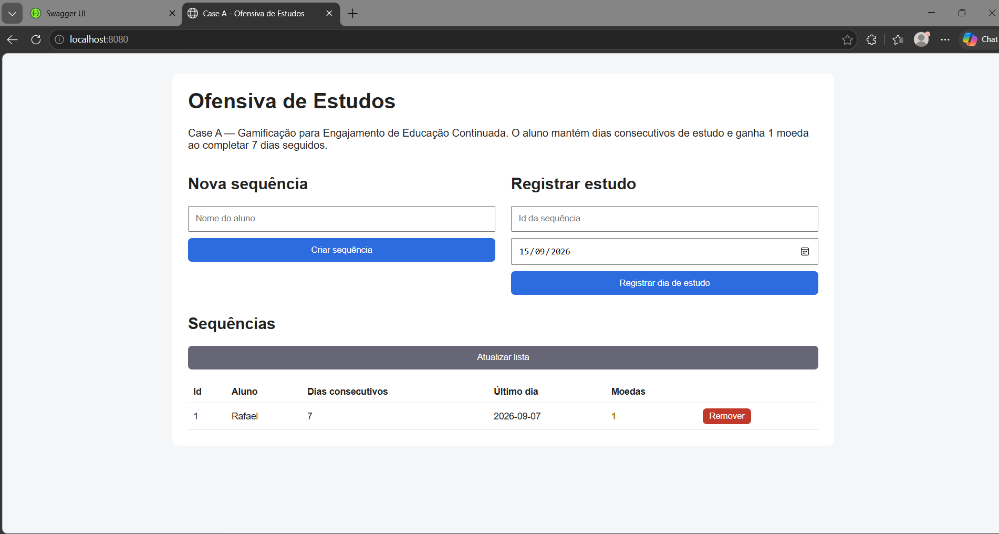
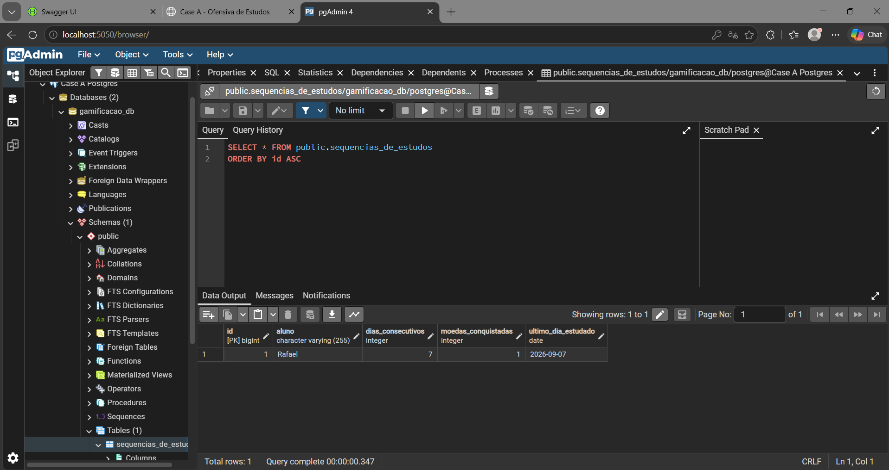
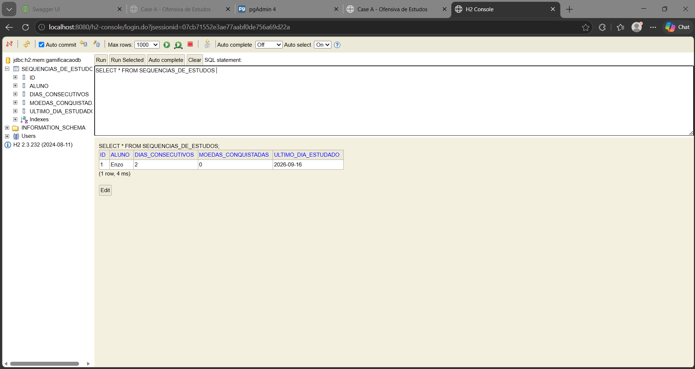

# Case A — Gamificação para Engajamento de Educação Continuada

Entrega da equipe aplicando **ATDD → BDD → TDD**.

> ✅ **Ciclo TDD completo: RED → GREEN → BLUE.** Todos os testes passam e a cobertura JaCoCo
> está em **100%**, sem amarelo nem vermelho.

## 👥 Equipe

- Yuri Peruzzo
- Enzo Zorzetto
- Pedro Ricci Gomes Nascimento

## 📖 Descrição do estudo de caso

**Case A — Gamificação para Engajamento de Educação Continuada.**

Uma determinada plataforma vende cursos online e EAD no modelo de assinaturas. O aluno paga um
valor mensal e tem acesso a um conjunto de cursos para assinatura básica. A cada curso terminado e
com média acima de 7,0, o aluno tem direito à realização de mais 3 cursos. O aluno que escrever
mais tópicos no fórum e ajudar outros participantes com seus comentários ganha um curso no final do
mês. Quando o aluno conquistar 12 cursos, seu plano de assinatura passa a ser "Premium" e ele passa
a receber voucher para participar de projetos reais durante os cursos, além de 3 moedas, que podem
ser convertidas em conhecimento (novos cursos), acumuladas ou recebidas por criptomoeda.

## 1) Product Backlog — 1 User Story por integrante

| #US | Integrante | As a | I want | So that | Escolhida pelo grupo |
|---|---|---|---|---|---|
| 1 | Yuri Peruzzo | COMO aluno assinante | QUERO manter uma sequência de dias consecutivos estudando (uma "ofensiva" de estudos) e ser recompensado automaticamente ao atingir marcos, como 7 dias seguidos | PARA criar o hábito de estudar com regularidade, não só quando termino um curso inteiro | ✅ **SIM** |
| 2 | Enzo Zorzetto | COMO administrador da plataforma | QUERO visualizar um ranking mensal dos alunos mais engajados no fórum | PARA identificar quem merece destaque e incentivar a comunidade a participar mais | Não |
| 3 | Pedro Ricci Gomes Nascimento | COMO aluno assinante | QUERO desbloquear selos/conquistas visuais (ex.: "Maratonista", "Mentor da Turma") ao atingir marcos de comportamento diferentes entre si | PARA exibir meu progresso de forma divertida e compartilhável, além das notas | Não |

### 2) US escolhida pelo grupo: US1 (Yuri Peruzzo)

> **COMO** aluno assinante
> **QUERO** manter uma sequência de dias consecutivos estudando (uma "ofensiva" de estudos) e ser
> recompensado automaticamente ao atingir marcos, como 7 dias seguidos
> **PARA** criar o hábito de estudar com regularidade, não só quando termino um curso inteiro.

A mecânica foi modelada na classe de domínio `SequenciaDeEstudos`, que premia a regularidade do
aluno, dia após dia.

## 3) BDD — Cenários de aceite da US1 (1 cenário por integrante)

| Cenário | Redigido por | Given | When | Then |
|---|---|---|---|---|
| 1 | **Yuri Peruzzo** | Dado que o aluno estudou ontem | Quando ele registra estudo hoje (dia seguinte) | Então sua sequência de dias consecutivos deve aumentar |
| 2 | **Enzo Zorzetto** | Dado que o aluno tinha uma sequência de 2 dias seguidos | Quando ele deixa passar um dia sem estudar e só volta a estudar depois | Então sua sequência deve reiniciar para 1 |
| 3 | **Pedro Ricci Gomes Nascimento** | Dado que o aluno estudou 6 dias seguidos | Quando ele estuda no 7º dia consecutivo | Então ele deve receber 1 moeda de recompensa pela sequência |

## 4) ATDD — Cenários automatizados em Cucumber

Os três cenários de BDD viraram Gherkin executável em
[`src/test/resources/features/sequencia_de_estudos.feature`](src/test/resources/features/sequencia_de_estudos.feature),
com os passos implementados em
[`SequenciaDeEstudosStepDefinitions`](src/test/java/br/edu/gamificacaocursos/acceptance/SequenciaDeEstudosStepDefinitions.java)
e a suíte executada por
[`RunCucumberTest`](src/test/java/br/edu/gamificacaocursos/acceptance/RunCucumberTest.java).

```gherkin
# language: pt
Funcionalidade: Ofensiva de estudos

  Cenário: Aumentar a sequência ao estudar em dias consecutivos
    Dado que o aluno "Rafael" estudou em "2026-09-01"
    Quando ele registra estudo em "2026-09-02"
    Então sua sequência de dias consecutivos deve ser 2

  Cenário: Reiniciar a sequência quando o aluno deixa passar um dia
    Dado que o aluno "Aline" estudou em "2026-09-01"
    E que ele também estudou em "2026-09-02"
    Quando ele deixa passar um dia e só volta a estudar em "2026-09-04"
    Então sua sequência de dias consecutivos deve ser 1

  Cenário: Receber moeda de recompensa ao completar 7 dias consecutivos
    Dado que o aluno "Pedro" começou a estudar em "2026-09-01"
    Quando ele estuda por 7 dias consecutivos
    Então sua sequência de dias consecutivos deve ser 7
    E ele deve ter 1 moeda conquistada
```

**Todos os passos são encontrados — nenhum passo indefinido.** No log do Cucumber, cada linha do
Gherkin aparece ligada ao seu método de glue. No RED, os cenários quebravam na **regra de negócio
ainda não implementada** — um critério de aceite falhando, e não o Cucumber sem saber executar o
passo. Com o GREEN, os três cenários passam.

## 5) Domínio e teste de domínio

| Camada | Pacote | Classe |
|---|---|---|
| Domínio (`src/main/java`) | `br.edu.gamificacaocursos.domain` | [`SequenciaDeEstudos`](src/main/java/br/edu/gamificacaocursos/domain/SequenciaDeEstudos.java) |
| Teste de domínio (`src/test/java`) | `br.edu.gamificacaocursos.domain` | [`SequenciaDeEstudosTest`](src/test/java/br/edu/gamificacaocursos/domain/SequenciaDeEstudosTest.java) |
| ATDD / glue (`src/test/java`) | `br.edu.gamificacaocursos.acceptance` | [`SequenciaDeEstudosStepDefinitions`](src/test/java/br/edu/gamificacaocursos/acceptance/SequenciaDeEstudosStepDefinitions.java) |

## 6.1) TDD — 1º passo: "teste para falhar" (RED)

Cada cenário de BDD virou também um teste de domínio em `SequenciaDeEstudosTest`, no formato
Arrange / Act / Assert:

| Cenário | Arrange (DADO) | Act (QUANDO) | Assert (ENTÃO) | Status |
|---|---|---|---|---|
| 1 | `new SequenciaDeEstudos("Rafael")`, 01/09 e 02/09 | `registrarEstudo(ontem)` e `registrarEstudo(hoje)` | `assertEquals(2, getDiasConsecutivos())` | 🔴 RED |
| 2 | `new SequenciaDeEstudos("Aline")`, 01/09, 02/09 e 04/09 (pulou o dia 3) | `registrarEstudo` nos três dias | `assertEquals(1, getDiasConsecutivos())` | 🔴 RED |
| 3 | `new SequenciaDeEstudos("Pedro")`, início em 01/09 | `registrarEstudo` em 7 dias seguidos | `assertEquals(7, getDiasConsecutivos())` e `assertEquals(1, getMoedasConquistadas())` | 🔴 RED |

Nesta etapa os três falhavam com `UnsupportedOperationException`, porque
`SequenciaDeEstudos.registrarEstudo(...)` ainda não tinha sido implementado:

```java
public void registrarEstudo(LocalDate data) {
    throw new UnsupportedOperationException("registrarEstudo ainda nao implementado (TDD RED).");
}
```

## ▶️ Como rodar

**Só os testes:**

```bash
mvn clean test
```

**A aplicação com H2, direto pela IDE ou pelo terminal** (perfil padrão):

```bash
mvn spring-boot:run
```

**Tudo via Docker, com PostgreSQL e pgAdmin:**

```bash
docker compose up --build
```

| Endereço | O que é |
|---|---|
| http://localhost:8080/ | front-end Vue |
| http://localhost:8080/swagger-ui.html | Swagger UI |
| http://localhost:8080/h2-console | console do H2 (só no perfil `h2`) |
| http://localhost:5050 | pgAdmin (só via Docker) |

## 🔴 1º passo — Evidência dos testes falhando (RED)

Saída real de `mvn test` **antes** da implementação (bloco `Results:` do Surefire):

```text
[INFO] Results:
[INFO]
[ERROR] Errors:
[ERROR]   RunCucumberTest.Aumentar a sequência ao estudar em dias consecutivos » UnsupportedOperation registrarEstudo ainda nao implementado (TDD RED).
[ERROR]   RunCucumberTest.Receber moeda de recompensa ao completar 7 dias consecutivos » UnsupportedOperation registrarEstudo ainda nao implementado (TDD RED).
[ERROR]   RunCucumberTest.Reiniciar a sequência quando o aluno deixa passar um dia » UnsupportedOperation registrarEstudo ainda nao implementado (TDD RED).
[ERROR]   SequenciaDeEstudosTest.aumentaSequenciaAoEstudarEmDiasConsecutivos:19 » UnsupportedOperation registrarEstudo ainda nao implementado (TDD RED).
[ERROR]   SequenciaDeEstudosTest.recebeMoedaAoCompletarSeteDiasConsecutivos:47 » UnsupportedOperation registrarEstudo ainda nao implementado (TDD RED).
[ERROR]   SequenciaDeEstudosTest.reiniciaSequenciaQuandoPulaUmDiaSemEstudar:33 » UnsupportedOperation registrarEstudo ainda nao implementado (TDD RED).
[INFO]
[ERROR] Tests run: 6, Failures: 0, Errors: 6, Skipped: 0
[INFO]
[INFO] BUILD FAILURE
```

As 6 execuções são os 3 testes de domínio (`SequenciaDeEstudosTest`) e os 3 cenários de aceitação
(`sequencia_de_estudos.feature`), todos parando no mesmo ponto:
`SequenciaDeEstudos.registrarEstudo(...)`.

| Suíte | Resultado | Por quê |
|---|---|---|
| `SequenciaDeEstudosTest` (3) | 🔴 3 erros | **TDD RED** — `registrarEstudo` ainda não implementado |
| `RunCucumberTest` → `sequencia_de_estudos.feature` (3) | 🔴 3 erros | **ATDD RED** — mesma causa, alcançada através do glue |

## 6.2) TDD — 2º passo: implementação mínima (GREEN)

Com os testes em RED, `registrarEstudo(...)` foi implementado com o mínimo necessário para
satisfazer os 3 cenários — nenhum teste foi alterado:

```java
public void registrarEstudo(LocalDate data) {
    // TDD - GREEN: implementacao minima para os 3 cenarios de aceite da US1.
    if (ultimoDiaEstudado != null && data.equals(ultimoDiaEstudado.plusDays(1))) {
        diasConsecutivos = diasConsecutivos + 1;
    } else {
        diasConsecutivos = 1;
    }

    ultimoDiaEstudado = data;

    if (diasConsecutivos == DIAS_PARA_RECOMPENSA) {
        moedasConquistadas = moedasConquistadas + MOEDAS_POR_MARCO;
    }
}
```

Como cada cenário é atendido:

| Cenário | Regra aplicada | Resultado |
|---|---|---|
| 1 — dias consecutivos | `data` é o dia seguinte ao último estudado → incrementa | `diasConsecutivos = 2` ✅ |
| 2 — pulou um dia | 04/09 não é o dia seguinte a 02/09 → reinicia | `diasConsecutivos = 1` ✅ |
| 3 — marco de 7 dias | ao chegar em `DIAS_PARA_RECOMPENSA`, credita a moeda | `7 dias` e `1 moeda` ✅ |

## ✅ 2º passo — Evidência dos testes passando (GREEN)

```text
[INFO] Tests run: 3, Failures: 0, Errors: 0, Skipped: 0 -- in br.edu.gamificacaocursos.domain.SequenciaDeEstudosTest
[INFO] Tests run: 3, Failures: 0, Errors: 0, Skipped: 0 -- in br.edu.gamificacaocursos.acceptance.RunCucumberTest
[INFO]
[INFO] Results:
[INFO]
[INFO] Tests run: 6, Failures: 0, Errors: 0, Skipped: 0
[INFO]
[INFO] BUILD SUCCESS
```

O TDD e o ATDD ficaram verdes juntos: os 3 testes de domínio e os 3 cenários de aceitação passam
com a mesma implementação, sem que nenhum teste ou passo de Gherkin fosse tocado.

### Cobertura ao final do GREEN (JaCoCo)

| Classe | Instruções | Branches | Linhas não cobertas |
|---|---|---|---|
| `SequenciaDeEstudos` | 🟡 90,2% | 🟢 100% | 2 de 17 |
| `GamificacaoCursosApplication` | 🔴 0% | — | 3 de 3 |
| **Total** | **79,7%** | **100%** | |

**Onde estava o amarelo e o vermelho:**

- 🟡 `SequenciaDeEstudos` — `getAluno()` e `getUltimoDiaEstudado()` não eram chamados por nenhum
  teste. Toda a regra de negócio de `registrarEstudo(...)` já estava coberta, inclusive 100% de
  branches (dia seguinte / dia pulado / marco atingido).
- 🔴 `GamificacaoCursosApplication` — classe de bootstrap do Spring Boot, sem teste que a exercitasse.

Fechar esses dois pontos foi a tarefa do 3º passo, a seguir.

## 6.3) TDD — 3º passo: refatoração (BLUE)

Com os testes verdes, `registrarEstudo(...)` foi refatorado para que **cada regra vire um método com
nome**, em vez de condições soltas dentro do fluxo. O comportamento é idêntico — nenhum teste
existente foi alterado:

```java
public void registrarEstudo(LocalDate data) {
    this.diasConsecutivos = ehDiaSeguinteAoUltimoEstudo(data)
            ? diasConsecutivos + 1
            : PRIMEIRO_DIA_DA_SEQUENCIA;
    this.ultimoDiaEstudado = data;

    premiarSeAtingiuMarco();
}

private boolean ehDiaSeguinteAoUltimoEstudo(LocalDate data) {
    return ultimoDiaEstudado != null && data.equals(ultimoDiaEstudado.plusDays(1));
}

private void premiarSeAtingiuMarco() {
    if (diasConsecutivos == DIAS_PARA_RECOMPENSA) {
        this.moedasConquistadas += MOEDAS_POR_MARCO;
    }
}
```

| O que mudou | Por quê |
|---|---|
| `ehDiaSeguinteAoUltimoEstudo(data)` extraído | o `if` dizia *como* verificar; o método diz *o que* se verifica |
| `premiarSeAtingiuMarco()` extraído | separa a contagem da sequência da regra de recompensa |
| Constante `PRIMEIRO_DIA_DA_SEQUENCIA` | elimina o número mágico `1` no reinício |
| Javadoc na classe e no método público | documenta a intenção da mecânica |

Para zerar o amarelo e o vermelho da cobertura, foram acrescentados **4 testes novos** — nenhum
teste anterior foi tocado:

| Teste novo | Cobre |
|---|---|
| `sequenciaNovaComecaZeradaEGuardaOAluno` | `getAluno()` e o estado inicial |
| `guardaOUltimoDiaEstudado` | `getUltimoDiaEstudado()` |
| `aplicacaoInicializaSemErro` | `GamificacaoCursosApplication.main(...)` |
| `classeDeBootstrapPodeSerInstanciada` | construtor da classe de bootstrap |

## ✅ 3º passo — Evidência final (BLUE): testes passando e cobertura 100%

```text
[INFO] Tests run: 5, Failures: 0, Errors: 0, Skipped: 0 -- in br.edu.gamificacaocursos.domain.SequenciaDeEstudosTest
[INFO] Tests run: 2, Failures: 0, Errors: 0, Skipped: 0 -- in br.edu.gamificacaocursos.GamificacaoCursosApplicationTest
[INFO] Tests run: 3, Failures: 0, Errors: 0, Skipped: 0 -- in br.edu.gamificacaocursos.acceptance.RunCucumberTest
[INFO]
[INFO] Results:
[INFO]
[INFO] Tests run: 10, Failures: 0, Errors: 0, Skipped: 0
[INFO]
[INFO] BUILD SUCCESS
```

Cobertura JaCoCo (`target/site/jacoco/index.html`):

| Classe | Instruções | Branches | Linhas | Métodos |
|---|---|---|---|---|
| `SequenciaDeEstudos` | 🟢 100% | 🟢 100% | 🟢 100% | 🟢 100% |
| `GamificacaoCursosApplication` | 🟢 100% | — | 🟢 100% | 🟢 100% |
| **Total** | **🟢 100%** | **🟢 100%** | **🟢 100%** | **🟢 100%** |

**Nenhuma classe em amarelo ou vermelho.** A coluna de branches da classe de bootstrap aparece
vazia porque ela não tem nenhum desvio condicional.

> Os números acima são os do **fechamento do ciclo TDD**, quando o projeto tinha só o domínio.
> Depois vieram as camadas web (seções 7 a 11) com seus próprios testes: hoje `mvn clean test`
> roda **25 testes** e a cobertura segue em **100% em todas as classes**, como mostra a seção
> seguinte.

### Cobertura atual, já com todas as camadas

```text
Tests run: 25, Failures: 0, Errors: 0, Skipped: 0
BUILD SUCCESS
```

| Classe | Cobertura |
|---|---|
| `SequenciaDeEstudos` (domínio + entidade) | 🟢 100% |
| `SequenciaDeEstudosService` | 🟢 100% |
| `SequenciaDeEstudosRestController` | 🟢 100% |
| `ApiExceptionHandler` | 🟢 100% |
| `GamificacaoCursosApplication` | 🟢 100% |

Os 25 testes são: 5 de domínio (TDD) + 3 cenários Cucumber (ATDD) + 8 de service + 7 de
controller + 2 de bootstrap. DTOs e a classe de configuração ficam fora do relatório JaCoCo —
são estruturas de dados e configuração, sem regra de negócio.

## 🔄 Resumo do ciclo TDD

| Passo | O que foi feito | Testes | Cobertura |
|---|---|---|---|
| 🔴 **RED** | 3 testes de domínio + 3 cenários Cucumber escritos antes do código | 6 falhando | — |
| ✅ **GREEN** | implementação mínima de `registrarEstudo(...)` | 6 passando | 🟡 79,7% |
| 🔵 **BLUE** | extração de métodos + 4 testes de cobertura | 10 passando | 🟢 100% |

## 7) Demais camadas — Entity, Repository, Service, DTO e Controller

Com o domínio pronto e testado, a aplicação ganhou as camadas em volta dele. A regra de negócio
**não foi reescrita em nenhuma delas** — quem sabe contar dias consecutivos e premiar o marco
continua sendo a `SequenciaDeEstudos`.

| Camada | Pacote | Classe | Papel |
|---|---|---|---|
| Domínio / Entity | `domain` | `SequenciaDeEstudos` | regra de negócio + mapeamento JPA (`@Entity`) |
| Repository | `repository` | `SequenciaDeEstudosRepository` | `JpaRepository`: `findAll`, `save`, `findByAluno`… |
| Service | `service` | `SequenciaDeEstudosService` | orquestra o caso de uso, `@Transactional` |
| DTO | `dto` | `SequenciaDeEstudosRequestDTO`, `RegistrarEstudoRequestDTO`, `SequenciaDeEstudosResponseDTO` | contrato de entrada e saída da API |
| Controller | `controller` | `SequenciaDeEstudosRestController` | expõe o HTTP, valida com `@Valid` |
| Tratamento de erro | `controller` | `ApiExceptionHandler` | `@RestControllerAdvice` centraliza os erros |
| Configuração | `config` | `OpenApiConfig` | monta a documentação OpenAPI |

A entidade é a **própria classe de domínio**, seguindo o modelo visto em aula: as anotações JPA
foram acrescentadas sem alterar nenhuma regra, e os testes do ciclo TDD continuam passando.

## 8) Endpoints expostos com Swagger

Com a aplicação no ar, a documentação interativa fica em:

**http://localhost:8080/swagger-ui.html** — o JSON do contrato fica em `/v3/api-docs`.

| Método | Rota | O que faz |
|---|---|---|
| `GET` | `/api/sequencias` | lista todas as ofensivas |
| `POST` | `/api/sequencias` | cria a ofensiva de um aluno |
| `GET` | `/api/sequencias/{id}` | busca uma ofensiva |
| `POST` | `/api/sequencias/{id}/estudos` | registra um dia de estudo e atualiza a sequência |
| `DELETE` | `/api/sequencias/{id}` | remove uma ofensiva |

### Evidência: a regra da US1 atravessando a API inteira

```bash
# 1) cria a sequencia do aluno
curl -X POST http://localhost:8080/api/sequencias -H "Content-Type: application/json" -d "{\"aluno\":\"Rafael\"}"
{"id":1,"aluno":"Rafael","diasConsecutivos":0,"ultimoDiaEstudado":null,"moedasConquistadas":0}

# 2) registra 7 dias consecutivos, de 01/09 a 07/09
curl -X POST http://localhost:8080/api/sequencias/1/estudos -H "Content-Type: application/json" -d "{\"data\":\"2026-09-01\"}"
{"id":1,"aluno":"Rafael","diasConsecutivos":7,"ultimoDiaEstudado":"2026-09-07","moedasConquistadas":1}

# 3) validacao do @Valid
curl -X POST http://localhost:8080/api/sequencias -H "Content-Type: application/json" -d "{\"aluno\":\"\"}"
{"erros":{"aluno":"Aluno e obrigatorio"},"status":400}
```

A moeda apareceu exatamente no 7º dia — a mesma regra construída no TDD, agora atravessando
controller, service, repository e banco.

## 9) Front-end em Vue.js

Duas formas de abrir, com o mesmo código:

- **Servido pela aplicação**: `src/main/resources/static/index.html` → abre em
  **http://localhost:8080/** (mesma origem, sem CORS).
- **Arquivo solto**: `frontend-vue/index.html` → basta abrir no navegador; aponta para
  `http://localhost:8080` e o controller libera CORS com `@CrossOrigin`.

A tela usa **Vue 3** e permite criar a ofensiva de um aluno, registrar um dia de estudo, listar as
sequências com dias consecutivos e moedas, e remover. Os erros vindos da API aparecem na tela.

## 10) Bancos: H2 e PostgreSQL

Dois perfis, trocados por uma variável de ambiente — nenhuma linha de código muda:

| Perfil | Arquivo | Banco | Quando é usado |
|---|---|---|---|
| `h2` | `application-h2.properties` | H2 em memória | padrão ao rodar pela IDE; console em `/h2-console` |
| `postgres` | `application-postgres.properties` | PostgreSQL | ativado automaticamente no Docker |

O `application.properties` define `spring.profiles.active=${SPRING_PROFILES_ACTIVE:h2}` — ou seja,
H2 por padrão, e `postgres` quando o Compose injeta a variável.

### Evidência do H2 rodando

```text
o.s.b.a.h2.H2ConsoleAutoConfiguration : H2 console available at '/h2-console'.
                                        Database available at 'jdbc:h2:mem:gamificacaodb'
o.s.b.w.embedded.tomcat.TomcatWebServer : Tomcat started on port 8080 (http) with context path '/'
b.e.g.GamificacaoCursosApplication      : Started GamificacaoCursosApplication
```

Console do H2: **http://localhost:8080/h2-console** — JDBC URL `jdbc:h2:mem:gamificacaodb`,
usuário `sa`, senha em branco.

### Evidência do PostgreSQL rodando

Com o Compose no ar, os três contêineres sobem e a aplicação conecta no Postgres:

```text
SERVICE    STATUS                   PORTS
app        Up 3 minutes             0.0.0.0:8080->8080/tcp
pgadmin    Up 3 minutes             0.0.0.0:5050->80/tcp
postgres   Up 3 minutes (healthy)   0.0.0.0:5432->5432/tcp
```

```text
org.hibernate.Version                   : Hibernate ORM core version 6.6.26.Final
o.s.b.w.embedded.tomcat.TomcatWebServer : Tomcat started on port 8080 (http)
b.e.g.GamificacaoCursosApplication      : Started GamificacaoCursosApplication in 11.12 seconds
```

**A tabela criada pelo Hibernate no PostgreSQL:**

```text
$ docker compose exec postgres psql -U postgres -d gamificacao_db -c "\d sequencias_de_estudos"

                                  Table "public.sequencias_de_estudos"
       Column        |          Type          | Collation | Nullable |             Default
---------------------+------------------------+-----------+----------+----------------------------------
 id                  | bigint                 |           | not null | generated by default as identity
 aluno               | character varying(255) |           | not null |
 dias_consecutivos   | integer                |           | not null |
 moedas_conquistadas | integer                |           | not null |
 ultimo_dia_estudado | date                   |           |          |
Indexes:
    "sequencias_de_estudos_pkey" PRIMARY KEY, btree (id)
```

**Os dados gravados, depois de registrar 7 dias consecutivos pela API:**

```text
$ docker compose exec postgres psql -U postgres -d gamificacao_db -c "SELECT * FROM sequencias_de_estudos;"

 id | aluno  | dias_consecutivos | moedas_conquistadas | ultimo_dia_estudado
----+--------+-------------------+---------------------+---------------------
  1 | Rafael |                 7 |                   1 | 2026-09-07
(1 row)

$ docker compose exec postgres psql -U postgres -d gamificacao_db -tc "SELECT version();"
 PostgreSQL 16.15 (Debian 16.15-1.pgdg13+2) on x86_64-pc-linux-gnu, 64-bit
```

A regra da US1 chegou íntegra até o banco: `dias_consecutivos = 7` e `moedas_conquistadas = 1`.

**pgAdmin:** http://localhost:5050 (`admin@admin.com` / `admin`). Para registrar o servidor:
host `postgres`, porta `5432`, banco `gamificacao_db`, usuário e senha `postgres`.

> Note que no perfil `postgres` o `/h2-console` responde **404** — é o esperado: o console do H2 só
> existe no perfil `h2`. É justamente essa diferença que comprova que a aplicação, dentro do
> Docker, está mesmo no PostgreSQL e não no H2.

## 11) Rodando via Docker

```bash
docker compose up --build
```

Sobem três contêineres:

| Serviço | Imagem | Porta | Para quê |
|---|---|---|---|
| `postgres` | `postgres:16` | 5432 | banco de dados |
| `pgadmin` | `dpage/pgadmin4:9` | 5050 | administrar o banco pelo navegador |
| `app` | build do `Dockerfile` | 8080 | a aplicação, no perfil `postgres` |

O `Dockerfile` usa **build em dois estágios**: o primeiro compila com Maven, o segundo copia apenas
o `.jar` para uma imagem JRE enxuta. O serviço `app` só inicia depois que o `healthcheck` do
Postgres passa (`depends_on: condition: service_healthy`), evitando o erro clássico de a aplicação
subir antes do banco estar pronto.

Com tudo no ar:

- Aplicação e front-end: **http://localhost:8080/**
- Swagger: **http://localhost:8080/swagger-ui.html**
- pgAdmin: **http://localhost:5050**

Para derrubar: `docker compose down` — ou `docker compose down -v` para apagar também os volumes.

## 📸 Evidências em imagem

Todos os prints ficam em [`docs/evidencias/`](docs/evidencias/).

### Aplicação rodando via Docker

As três imagens construídas e em uso — `postgres:16`, `dpage/pgadmin4:9` e a `dq-app`, gerada pelo
`Dockerfile` do projeto:



Os contêineres correspondentes, com o `healthcheck` do banco:

```text
SERVICE    STATUS                   PORTS
app        Up 3 minutes             0.0.0.0:8080->8080/tcp
pgadmin    Up 3 minutes             0.0.0.0:5050->80/tcp
postgres   Up 3 minutes (healthy)   0.0.0.0:5432->5432/tcp
```

### Endpoints expostos com Swagger

Os cinco endpoints documentados e os três DTOs em *Schemas*:



### Front-end em Vue.js

A tela consumindo a API, com os dias consecutivos e as moedas de cada aluno:



### PostgreSQL rodando

Consulta no pgAdmin mostrando a linha gravada pela API — `dias_consecutivos = 7` e
`moedas_conquistadas = 1`, exatamente a regra da US1 ao completar a ofensiva de 7 dias:



### H2 rodando

O mesmo esquema no H2 em memória, com a JDBC URL `jdbc:h2:mem:gamificacaodb` visível na árvore à
esquerda. É a mesma aplicação, só trocando o perfil — nenhuma linha de código muda:



## 📁 Estrutura

```text
case-a-gamificacao-cursos/
├── pom.xml
├── README.md
├── Dockerfile                  <- build em 2 estagios
├── docker-compose.yml          <- app + postgres + pgadmin
├── .dockerignore
├── docs/evidencias/            <- prints das evidencias
├── frontend-vue/
│   └── index.html              <- front Vue standalone
└── src/
    ├── main/
    │   ├── java/br/edu/gamificacaocursos/
    │   │   ├── GamificacaoCursosApplication.java
    │   │   ├── config/OpenApiConfig.java                    <- Swagger
    │   │   ├── controller/
    │   │   │   ├── SequenciaDeEstudosRestController.java    <- endpoints REST
    │   │   │   └── ApiExceptionHandler.java
    │   │   ├── domain/SequenciaDeEstudos.java               <- dominio + @Entity
    │   │   ├── dto/
    │   │   │   ├── SequenciaDeEstudosRequestDTO.java
    │   │   │   ├── RegistrarEstudoRequestDTO.java
    │   │   │   └── SequenciaDeEstudosResponseDTO.java
    │   │   ├── repository/SequenciaDeEstudosRepository.java
    │   │   └── service/SequenciaDeEstudosService.java
    │   └── resources/
    │       ├── application.properties
    │       ├── application-h2.properties
    │       ├── application-postgres.properties
    │       └── static/index.html                            <- front Vue servido pelo Spring
    └── test/
        ├── java/br/edu/gamificacaocursos/
        │   ├── GamificacaoCursosApplicationTest.java
        │   ├── acceptance/
        │   │   ├── RunCucumberTest.java                     <- runner do Cucumber
        │   │   └── SequenciaDeEstudosStepDefinitions.java   <- ATDD
        │   ├── controller/SequenciaDeEstudosRestControllerTest.java
        │   ├── domain/SequenciaDeEstudosTest.java           <- TDD
        │   └── service/SequenciaDeEstudosServiceTest.java
        └── resources/features/
            └── sequencia_de_estudos.feature                 <- BDD
```

## 🛠️ Tecnologias

- Java 17 e Maven
- Spring Boot 3.5.5 — Web, Data JPA, Validation
- Banco H2 (perfil `h2`) e PostgreSQL 16 (perfil `postgres`)
- springdoc-openapi 2.8.11 (Swagger UI)
- Vue.js 3
- Docker e Docker Compose (app + postgres + pgadmin)
- JUnit Jupiter e Cucumber 7 (cucumber-java + cucumber-junit-platform-engine)
- JaCoCo 0.8.12 (cobertura de testes)
- IntelliJ IDEA Ultimate
