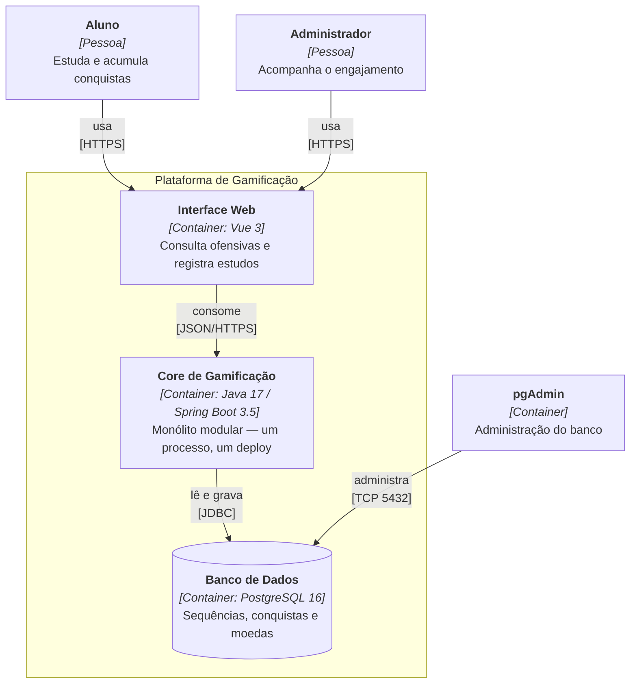
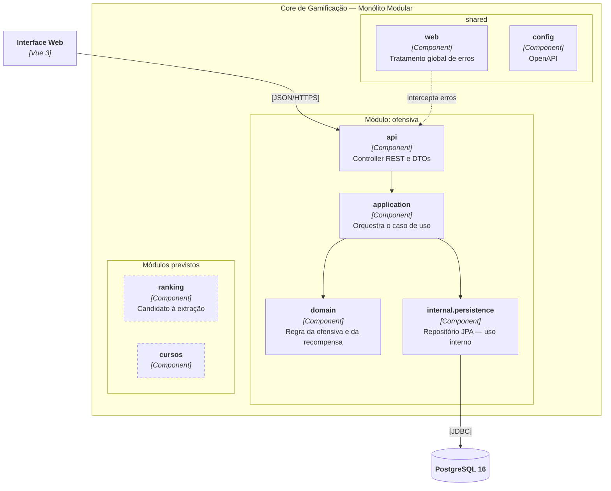
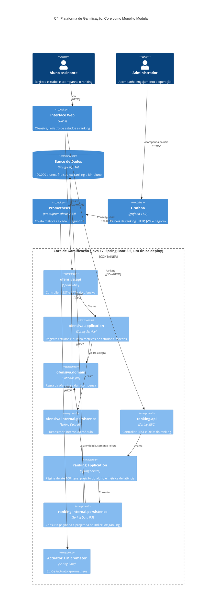
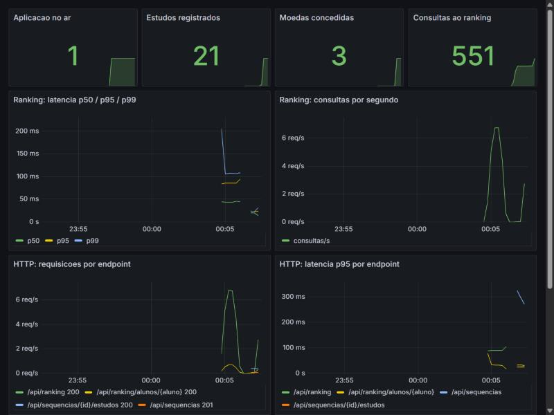

# Registro Arquitetural — Case A: Gamificação para Educação Continuada

Registro cumulativo das decisões do Architecture Lab (B1). Cada desafio acrescenta uma linha à
matriz de ASRs, um ADR e a visão C4 afetada.

**Equipe (3 integrantes):** Yuri Peruzzo · Enzo Zorzetto · Pedro Ricci Gomes Nascimento

| Desafio | Tema | ADR | Status |
|---|---|---|---|
| 1 | Drivers e evolução do Core | [ADR-001](#adr-001--evoluir-o-core-para-monólito-modular) | ✅ Concluído |
| 2 | Organização interna do Core | — | Pendente |
| 3 | Serviço Python e IA | — | Pendente |
| 4 | Comunicação e eventos | — | Pendente |
| 5 | IoT e MQTT | — | Pendente |
| 6 | CI/CD e observabilidade | — | Pendente |

## Matriz cumulativa de ASRs

| ID | ASR | Qualidade (FURPS+) | Origem | Desafio | Decisão que o atende |
|---|---|---|---|---|---|
| ASR-01 | Regras de gamificação mudam com frequência e a mudança não pode se espalhar pelo sistema | Supportability — manutenibilidade | RF01, RF02 | 1 | ADR-001 |
| ASR-02 | Leitura de ranking cresce de forma desproporcional às demais funcionalidades | Performance — escalabilidade | RF01 | 1 | ADR-001 |
| ASR-03 | A operação precisa caber em uma equipe de 3 pessoas, sem time de plataforma | Supportability — complexidade operacional | RPC-02 | 1 | ADR-001 |
| ASR-04 | O ranking precisa atender 100.000 alunos sem degradar | Performance — desempenho | RF01 | AC2 | ADR-002 |
| ASR-05 | As hipóteses de desempenho precisam ser verificáveis em execução | Supportability — observabilidade | ASR-02, ASR-04 | AC2 | ADR-003 |

---

# DESAFIO 1 — Drivers e evolução do Core

> **Prática B1 — itens 1 a 4** (leitura da solução proposta, análise do legado e estudo
> dos dois códigos-modelo) está em [`pratica-b1.md`](pratica-b1.md), com as quatro bases
> medidas pela mesma ferramenta de dependências.

> **Cadeia de rastreabilidade:** RF → RNF → ASR + RPC → alternativas/trade-offs → ADR → C4 → evidência.
> Cada seção abaixo é um elo; o resumo fechado está em [Rastreabilidade](#9-rastreabilidade-do-desafio-1).

## 1. RF — o que o sistema precisa fazer

| ID | Requisito funcional | Situação na AC1 |
|---|---|---|
| RF01 | Ranking de alunos | Não implementado; previsto para o B1 |
| RF02 | Conquistas e recompensas por comportamento | Implementado na US1 — ofensiva de dias consecutivos, com moeda ao atingir 7 dias |
| RF-evo | Evolução contínua de cursos, moedas e badges | Em andamento |

## 2. RNF — qualidades analisadas

| RNF | FURPS+ | Por que entra na análise |
|---|---|---|
| Manutenibilidade | Supportability | As regras de gamificação são o que mais muda no produto |
| Desempenho | Performance | A consulta de ranking tende a ser a mais frequente |
| Escalabilidade | Performance | Salto projetado de 1.000 para 100.000 usuários |
| Testabilidade | Supportability | A AC1 nasceu de TDD e a cobertura precisa ser preservada |
| Complexidade operacional | Supportability | Equipe de 3 pessoas, sem time de plataforma |

## 3. ASR — seleção

Dos cinco RNFs acima, **três** dirigem esta decisão.

| ASR | RNF | Como altera a arquitetura |
|---|---|---|
| **ASR-01** | Manutenibilidade | Altera a **estrutura**: exige fronteiras explícitas por capacidade de negócio, para que uma mudança em conquistas não force tocar ranking, cursos e recompensas. |
| **ASR-02** | Escalabilidade | Altera a **implantação** futura: o ranking cresce em leitura mais rápido que o resto, então a parte que escala precisa ser isolável sem reescrever o produto. |
| **ASR-03** | Complexidade operacional | Altera a **operação**: com 3 pessoas e sem esteira madura, cada artefato independente a mais transfere esforço de produto para infraestrutura. |

### RNFs que não viraram ASR

- **Desempenho** — o gargalo previsto é a leitura do ranking, tratável com índice, projeção de
  leitura ou cache dentro de um único artefato. Não muda estrutura, comunicação, dados nem
  implantação agora; vira ASR se a medição do Desafio 6 mostrar que a leitura compete por recurso
  com a escrita.
- **Testabilidade** — já atendida pelo ciclo TDD da AC1 (25 testes, cobertura 100%). É critério de
  não regressão da decisão, não driver dela.

## 4. RPC — restrições e premissas

| ID | Restrição / premissa | Efeito no espaço de decisão |
|---|---|---|
| RPC-01 | Core permanece em Java 17 / Spring Boot | Elimina reescrita de plataforma; a decisão é sobre organização, não sobre linguagem |
| RPC-02 | **Equipe de 3 desenvolvedores** | Limita quantos artefatos independentes podem ser operados com segurança |
| RPC-03 | Banco relacional único (PostgreSQL), herdado da AC1 | Separar serviços exigiria separar dados — custo não previsto nesta etapa |
| RPC-04 | Legado funcional da AC1 em operação | A evolução precisa ser incremental, sem parar a entrega |
| RPC-05 | Contratos REST existentes devem continuar válidos | A reorganização não pode quebrar os endpoints já publicados |

> O cenário do exercício cita uma equipe de 6 desenvolvedores. A equipe real deste projeto tem **3**.
> A restrição é, portanto, mais rígida do que a do enunciado — o que reforça a decisão em vez de
> enfraquecê-la: menos pessoas disponíveis tornam a complexidade distribuída ainda menos sustentável.

## 5. Decisão do Tech Lead

**Quais RNFs tornam-se ASRs?** Manutenibilidade, escalabilidade e complexidade operacional
(ASR-01 a ASR-03). Desempenho e testabilidade ficam fora pelos motivos da seção 3.

**Há necessidade comprovada de escala ou deploy independente?** Não. O crescimento do ranking é
**projeção, não medição**. Existe um único fluxo em produção e nenhuma métrica mostrando que a
leitura de ranking compete por recursos com o restante. Separar agora seria decidir por antecipação.

**A complexidade distribuída é justificável?** Não neste momento. Com RPC-02 (3 pessoas) e RPC-03
(banco único), a decomposição traria rede, consistência distribuída, versionamento de contratos e
observabilidade por serviço — custos reais pagos contra um benefício ainda hipotético.

**Decisão:** evoluir o Core de **Monólito em Camadas** para **Monólito Modular**, mantendo processo,
artefato e banco únicos, e organizando o código por **capacidade de negócio** em vez de camada
técnica. O ranking fica registrado como primeiro candidato à extração, condicionada à medição no
Desafio 6.

## 6. Alternativas e trade-offs

| Critério | (A) Monólito em Camadas | (B) Monólito Modular | (C) Ranking como serviço |
|---|---|---|---|
| Simplicidade inicial | Alta | Média | Baixa |
| Controle de acoplamento | Médio — degrada com o crescimento | Alto — limites explícitos | Alto — limite físico |
| Manutenibilidade (ASR-01) | Tende a degradar | **Atende** | Atende |
| Escala independente (ASR-02) | Não oferece | Prepara a extração | **Oferece hoje** |
| Complexidade operacional (ASR-03) | Baixa | **Baixa** | Alta — rede, dados, observabilidade |
| Deploy | Único | Único | Independente por serviço |
| Banco de dados | Único | Único | Exigiria separação — fere RPC-03 |
| Custo para 3 desenvolvedores (RPC-02) | Baixo | Baixo/Médio | Alto |
| Risco principal | Erosão da estrutura | Disciplina de fronteiras | Overengineering |

**Trade-off aceito na opção B:** o deploy continua único, então uma falha em qualquer módulo derruba
o artefato inteiro, e não há ganho imediato de escala em runtime. Em troca, o acoplamento passa a
ser contido por fronteiras e a extração futura deixa de exigir reescrita. Aceita-se também a
disciplina estrutural: a fronteira do módulo é convenção, e só se sustenta se a equipe não a
atravessar por conveniência.

**Por que (A) foi descartada:** atende ASR-03, mas não ASR-01 nem ASR-02. Com o crescimento
previsto, a organização por camada faz qualquer mudança de regra atravessar `controller`, `service`,
`repository` e `dto`.

**Por que (C) foi descartada:** atenderia ASR-02 de imediato, mas viola ASR-03 e RPC-03, e resolve
um problema que ainda não foi observado.

---

## ADR-001 — Evoluir o Core para Monólito Modular

**Status:** Aceito · **Data:** 2026-10-08 · **Desafio:** 1

### Contexto

O MVP da AC1 foi construído para ~1.000 usuários como monólito organizado em camadas técnicas
(`controller`, `service`, `repository`, `dto`, `domain`). O produto passa a projetar 100.000
usuários, com o ranking crescendo mais que as demais funcionalidades, enquanto cursos, conquistas e
recompensas seguem evoluindo. A equipe tem 3 desenvolvedores, o Core é Java 17 / Spring Boot e o
banco relacional é único e herdado.

### ASRs e RPCs que dirigem a decisão

- **ASR-01** manutenibilidade · **ASR-02** escalabilidade do ranking · **ASR-03** complexidade
  operacional compatível com 3 pessoas
- **RPC-01** Java 17 / Spring Boot · **RPC-02** equipe de 3 · **RPC-03** banco relacional único ·
  **RPC-04** legado da AC1 em operação · **RPC-05** contratos REST preservados

### Alternativas consideradas

(A) manter Monólito em Camadas · (B) evoluir para Monólito Modular · (C) extrair o ranking como
serviço independente.

### Decisão

Adotada a alternativa **(B) Monólito Modular**. O código passa a ser organizado por capacidade de
negócio, com `ofensiva` como primeiro módulo e `shared` para o que é transversal. Cada módulo tem
subcamadas internas `api`, `application`, `domain` e `internal/persistence`, e um `package-info.java`
que declara sua responsabilidade. Processo, artefato e banco permanecem únicos.

### Consequências

**Positivas**

- O acoplamento entre partes do produto passa a ser contido dentro do módulo: a evidência mediu
  **8 dependências cruzando o primeiro nível antes e 0 depois**.
- Uma mudança nas regras de conquista fica restrita a `ofensiva/`, sem tocar o que for de ranking,
  cursos ou recompensas.
- O segmento `internal/` marca explicitamente o que não deve ser consumido de fora do módulo.
- A extração futura do ranking deixa de ser reescrita e passa a ser o recorte de uma fronteira que
  já existe.
- Custo operacional inalterado: um artefato, um pipeline, um banco.
- Contratos REST preservados (RPC-05): os endpoints não mudaram e os 25 testes seguem verdes.

**Negativas / trade-offs aceitos**

- Nenhum ganho imediato de escala ou isolamento de falha — o deploy continua único.
- A fronteira é convenção, não barreira física: depende de disciplina da equipe e de revisão de
  código para não ser atravessada.
- Exige mais desenho inicial: cada funcionalidade nova precisa ser alocada a um módulo.
- Com apenas um módulo de negócio implementado, o benefício é hoje estrutural e se confirma à
  medida que `ranking` e `cursos` forem criados.

**Dívida registrada**

A medição expôs `ofensiva.application → ofensiva.api`: a camada de aplicação depende do contrato de
saída da API. É dependência na direção errada e fica como entrada para o **Desafio 2**, que trata
justamente de qual dependência precisa ser invertida.

### Condição de revisão

Este ADR deve ser reaberto se a observabilidade do Desafio 6 demonstrar que a leitura de ranking
compete por recurso com as operações de escrita, ou se a equipe crescer a ponto de o artefato único
virar gargalo de entrega.

---

## 7. C4 — visões afetadas

### Nível 2 — Container

A decisão é interna ao Core: o número de containers não muda. O diagrama registra o estado após o
ADR-001 e serve de base para os desafios seguintes.



### Nível 3 — Component (Core de Gamificação)

É aqui que o ADR-001 aparece: os componentes deixam de ser agrupados por camada técnica e passam a
ser agrupados por capacidade de negócio.



---

## 8. Evidência — mini-lab de modularização

A funcionalidade da AC1 (ofensiva de estudos, RF02) foi reorganizada de camada técnica para
capacidade de negócio, e as dependências foram medidas antes e depois.

### Estrutura antes e depois

```text
ANTES — por camada técnica          DEPOIS — por capacidade de negócio
br.edu.gamificacaocursos/           br.edu.gamificacaocursos/
├── config/                         ├── ofensiva/
├── controller/                     │   ├── package-info.java
├── domain/                         │   ├── api/
├── dto/                            │   ├── application/
├── repository/                     │   ├── domain/
└── service/                        │   └── internal/persistence/
                                    └── shared/
                                        ├── package-info.java
                                        ├── config/
                                        └── web/
```

O segmento `internal/` segue a convenção de marcar o que é detalhe do módulo e não deve ser
consumido de fora. O `package-info.java` declara a responsabilidade de cada módulo.

### Dependências medidas

Relatórios em [`evidencias/dependencias-antes.txt`](evidencias/dependencias-antes.txt) e
[`evidencias/dependencias-depois.txt`](evidencias/dependencias-depois.txt), gerados por
[`evidencias/analisar-dependencias.py`](evidencias/analisar-dependencias.py), que conta os imports
entre pacotes do próprio projeto.

| Métrica | Antes | Depois |
|---|---|---|
| Pacotes de primeiro nível | 7 | 3 |
| Dependências entre pacotes | 8 | 5 |
| **Dependências que cruzam o primeiro nível** | **8** | **0** |

```text
ANTES                                   DEPOIS
controller -> dto           3           ofensiva.api                  -> ofensiva.application          1
controller -> service       1           ofensiva.application          -> ofensiva.api                  1
repository -> domain        1           ofensiva.application          -> ofensiva.domain               1
service    -> domain        1           ofensiva.application          -> ofensiva.internal.persistence 1
service    -> dto           1           ofensiva.internal.persistence -> ofensiva.domain               1
service    -> repository    1
```

### Leitura do resultado

Duas coisas aconteceram.

**O acoplamento foi contido.** As dependências que restaram são **todas internas** ao módulo
`ofensiva`: nenhuma cruza o primeiro nível. Antes, as 8 atravessavam pacotes técnicos — qualquer
módulo futuro precisaria se misturar aos mesmos `controller`, `service` e `repository`. Agora um
módulo novo (`ranking`, `cursos`) nasce sem tocar em nada do que existe. É isso que sustenta ASR-01
e prepara ASR-02.

**Três dependências desapareceram.** Os 3 imports `controller → dto` deixaram de existir porque os
DTOs passaram a morar no mesmo pacote `api` do controller que os usa. Não é ganho cosmético: é
coesão — o contrato de entrada e saída fica junto de quem o publica.

### Não regressão

A reorganização preservou comportamento e contratos (RPC-05):

```text
[INFO] Tests run: 2, Failures: 0, Errors: 0 -- GamificacaoCursosApplicationTest
[INFO] Tests run: 7, Failures: 0, Errors: 0 -- ofensiva.api.SequenciaDeEstudosRestControllerTest
[INFO] Tests run: 8, Failures: 0, Errors: 0 -- ofensiva.application.SequenciaDeEstudosServiceTest
[INFO] Tests run: 5, Failures: 0, Errors: 0 -- ofensiva.domain.SequenciaDeEstudosTest
[INFO] Tests run: 3, Failures: 0, Errors: 0 -- ofensiva.acceptance.RunCucumberTest
[INFO]
[INFO] Tests run: 25, Failures: 0, Errors: 0, Skipped: 0
[INFO] BUILD SUCCESS
```

Cobertura JaCoCo após a reorganização: **100%**. Os endpoints seguem em `/api/sequencias`.

### Como reproduzir

```bash
mvn clean test
python docs/arquitetura/evidencias/analisar-dependencias.py src/main/java/br/edu/gamificacaocursos "DEPOIS"
```

---

## 9. Rastreabilidade do Desafio 1

| Elo | Conteúdo | Onde |
|---|---|---|
| **RF** | RF01 Ranking · RF02 Conquistas | [§1](#1-rf--o-que-o-sistema-precisa-fazer) |
| **RNF** | Manutenibilidade, desempenho, escalabilidade, testabilidade, complexidade operacional | [§2](#2-rnf--qualidades-analisadas) |
| **ASR** | ASR-01, ASR-02, ASR-03 — desempenho e testabilidade descartados com justificativa | [§3](#3-asr--seleção) |
| **RPC** | RPC-01 a RPC-05 — equipe de 3, banco único, Java/Spring, legado, contratos | [§4](#4-rpc--restrições-e-premissas) |
| **Alternativas** | (A) Camadas · (B) Modular · (C) Serviço — com trade-offs | [§6](#6-alternativas-e-trade-offs) |
| **ADR** | ADR-001 — Monólito Modular | [ADR-001](#adr-001--evoluir-o-core-para-monólito-modular) |
| **C4** | Container (sem mudança) + Component (reorganizado) | [§7](#7-c4--visões-afetadas) |
| **Evidência** | 8 → 0 dependências cruzando o topo, 25 testes verdes | [§8](#8-evidência--mini-lab-de-modularização) |

```text
RF01 Ranking ─────────┐
RF02 Conquistas ──────┤
                      ▼
      RNF: manutenibilidade · desempenho · escalabilidade ·
           testabilidade · complexidade operacional
                      ▼
      ASR-01 + ASR-02 + ASR-03      (desempenho e testabilidade descartados)
                      +
      RPC-01 Java/Spring · RPC-02 equipe de 3 · RPC-03 banco único ·
      RPC-04 legado da AC1 · RPC-05 contratos REST
                      ▼
      Alternativas A / B / C   →   trade-offs
                      ▼
      ADR-001: Monólito Modular
                      ▼
      C4 Container (inalterado) + C4 Component (por capacidade)
                      ▼
      Evidência: 8 → 0 dependências cruzando o topo, com 25 testes verdes
```

---

# ENTREGA AC2 — itens 6 e 7

Esta seção atende os dois últimos itens pedidos para o README do Exercício B1: o **diagrama C4** e a
evolução do **legado da AC1** (implementação do Ranking para 100.000 alunos, comparação Monólito
Modular × Camadas, cobertura de 100%, observabilidade com Grafana/Prometheus e caso de teste com
Mockito). Os itens 1 a 5 (RF, RNF, ASR, RPC e ADR) estão no Desafio 1, acima.

## 6) Diagrama C4 em código Mermaid

Um único diagrama reúne as três visões: as pessoas e os sistemas externos (contexto), a Interface
Web, o banco, o Prometheus e o Grafana (containers) e, dentro do Core, os módulos `ofensiva` e
`ranking` com suas camadas internas (componentes). Assim a fronteira do monólito modular, a única
dependência entre módulos (`ranking.internal.persistence → ofensiva.domain`, somente leitura) e o
caminho da observabilidade aparecem na mesma figura. O GitHub renderiza o código direto nesta
página, e o fonte está versionado em [`c4-gamificacao.mmd`](c4/c4-gamificacao.mmd).



## 7) AC1 → legado

### 7.1 Implementação: módulo Ranking (RF01)

O RF01, que no Desafio 1 ainda estava apenas previsto, foi implementado como um novo módulo do
monólito modular, na mesma convenção do módulo `ofensiva`:

```text
ranking/
├── package-info.java
├── api/                    RankingRestController, RankingItemDTO, RankingPaginaDTO
├── application/            RankingService
└── internal/persistence/   RankingRepository, LinhaDoRanking
```

| Método | Rota | O que faz |
|---|---|---|
| `GET` | `/api/ranking?pagina=0&tamanho=20` | página do ranking, ordenada por moedas, depois dias consecutivos, depois nome |
| `GET` | `/api/ranking/alunos/{aluno}` | posição de um aluno específico |

Os dois endpoints aparecem no Swagger junto com os da ofensiva.

### 7.2 Monólito Modular × Camadas

No Desafio 1 havia uma ressalva: com um único módulo de negócio, "0 dependências entre módulos" era
verdadeiro, mas não provava nada. Com o ranking implementado, a medição passou a ter dois módulos
reais. Relatório em [`evidencias/dependencias-com-ranking.txt`](evidencias/dependencias-com-ranking.txt).

| Base | Módulos de negócio | Dependências | Cruzando módulos | % |
|---|---|---|---|---|
| Modelo de referência, Camadas | 4 | 43 | 38 | 88% |
| Modelo de referência, Modular | 4 | 30 | 7 | 23% |
| Nossa AC1, em camadas | 1 | 8 | 8 | 100% |
| Nosso Core, Desafio 1 | 1 | 5 | 0 | 0% |
| **Nosso Core, com o Ranking** | **2** | **11** | **1** | **9%** |

A única dependência entre módulos é `ranking.internal.persistence → ofensiva.domain`: o ranking lê
a entidade `SequenciaDeEstudos` para montar a classificação. Ela aponta para o **domínio** do outro
módulo, e não para o `internal` dele. No modelo de referência, quatro das sete dependências entre
módulos alcançavam o `internal.persistence` alheio.

Na versão em camadas, o mesmo ranking teria espalhado controller, service, repository e DTOs pelos
pacotes técnicos já usados pela ofensiva. Aqui ele nasceu numa pasta própria, sem tocar em nenhum
arquivo do módulo `ofensiva` além do índice na entidade.

### 7.3 Ranking para 100.000 alunos

O cenário do B1 fixa a escala em **100.000 usuários**. Com um número explícito, o desempenho do
ranking deixa de ser projeção e passa a ser **ASR-04** (veja a matriz). Ele foi atendido dentro do
monólito, sem extrair serviço:

| Decisão | Por que importa com 100.000 alunos |
|---|---|
| Página limitada a **100 itens** (padrão 20) | nunca trafega nem serializa 100.000 linhas; pedido acima do limite devolve 400 |
| Consulta por **projeção** (`LinhaDoRanking`) | lê só aluno, moedas e dias, sem montar entidades JPA |
| Índice composto **`idx_ranking`** (moedas desc, dias desc, aluno) | o banco entrega a ordem pronta, sem ordenar a tabela inteira |
| Posição calculada por **contagem** de quem está à frente | não percorre páginas para achar um aluno |
| Transação **somente leitura** | o Hibernate não rastreia alterações nas linhas lidas |

**Evidência** ([`RankingCargaTest`](../../src/test/java/br/edu/gamificacaocursos/ranking/RankingCargaTest.java)):
o teste insere 100.000 alunos no H2 e verifica o comportamento.

```text
RANKING_100K pagina 0 (20 itens) em 32 ms
RANKING_100K posicao de aluno-020823 = 168 em 214 ms
RANKING_100K plano:
    /* PUBLIC.IDX_RANKING */
```

| Verificação | Resultado |
|---|---|
| Total de alunos e de páginas | 100.000 alunos, 5.000 páginas de 20 |
| Primeira página | 20 itens, o primeiro com a maior quantidade de moedas da base |
| Ordenação | cada item tem moedas maiores, ou iguais com dias maiores ou iguais, que o seguinte |
| Posição de um aluno | a posição calculada é igual à posição dele na listagem (168) |
| Plano de execução | o banco usa `IDX_RANKING` para ordenar |

Os tempos foram medidos em H2 em memória e servem como ordem de grandeza. A medida que vale para a
arquitetura é a do PostgreSQL, coletada pelo Prometheus (item 7.5). A consulta de posição é mais
lenta que a de página porque a contagem combina três condições; se a observabilidade mostrar que ela
pesa, o próximo passo é materializar uma pontuação única indexada.

### 7.4 100% de cobertura (JaCoCo / JUnit)

```text
Tests run: 41, Failures: 0, Errors: 0, Skipped: 0
BUILD SUCCESS
```

| Classe | Instruções | Branches |
|---|---|---|
| `ofensiva.domain.SequenciaDeEstudos` | 100% | 100% |
| `ofensiva.application.SequenciaDeEstudosService` | 100% | 100% |
| `ofensiva.api.SequenciaDeEstudosRestController` | 100% | 100% |
| `ranking.application.RankingService` | 100% | 100% |
| `ranking.api.RankingRestController` | 100% | 100% |
| `ranking.internal.persistence.LinhaDoRanking` | 100% | 100% |
| `shared.web.ApiExceptionHandler` | 100% | 100% |
| `GamificacaoCursosApplication` | 100% | 100% |
| **Total** | **100%** | **100%** |

Os 41 testes: 5 de domínio (TDD), 3 cenários Cucumber (ATDD), 8 de service com banco, 4 de service
com Mockito, 7 de controller da ofensiva, 5 de service do ranking com Mockito, 4 de controller do
ranking, 3 de carga com 100.000 alunos e 2 de inicialização. DTOs, `package-info` e a configuração do
OpenAPI ficam fora do relatório por não terem regra.

### 7.5 Observabilidade: Prometheus e Grafana

**Por que.** As decisões dos ADRs 001 e 002 se apoiam em hipóteses de desempenho: que o ranking
paginado e indexado aguenta 100.000 alunos dentro do monólito, e que não é preciso extraí-lo. Sem
medição em execução essas hipóteses não podem ser confirmadas nem refutadas. A observabilidade é o
que transforma a condição de revisão do ADR-001 ("reabrir se a leitura do ranking competir por
recurso") em algo verificável.

**O que é medido.**

| Métrica | Origem | Responde a |
|---|---|---|
| `gamificacao_ranking_consulta_seconds` (histograma) | `RankingService` | o ranking continua rápido com 100.000 alunos? (p50, p95, p99) |
| `gamificacao_ofensiva_estudos_total` | `SequenciaDeEstudosService` | quantos dias de estudo estão sendo registrados |
| `gamificacao_ofensiva_moedas_total` | `SequenciaDeEstudosService` | quantas ofensivas de 7 dias foram completadas |
| `http_server_requests_seconds` | Spring Boot | latência e volume por endpoint |
| `jvm_memory_used_bytes` | Micrometer | memória do único processo do monólito |
| `up` | Prometheus | a aplicação está no ar |

As métricas são expostas em `/actuator/prometheus` (Spring Boot Actuator + Micrometer). O
Prometheus coleta a cada 5 segundos e o Grafana já sobe com a fonte de dados e o dashboard
**Gamificacao - Ofensiva e Ranking** provisionados, com 10 painéis.

| Arquivo | Papel |
|---|---|
| [`prometheus.yml`](../../observabilidade/prometheus/prometheus.yml) | alvo de coleta `app:8080/actuator/prometheus` |
| [`datasource.yml`](../../observabilidade/grafana/provisioning/datasources/datasource.yml) | Prometheus como fonte de dados padrão |
| [`gamificacao.json`](../../observabilidade/grafana/dashboards/gamificacao.json) | o dashboard |
| [`carga-100k.sql`](../../observabilidade/carga-100k.sql) | popula o PostgreSQL com 100.000 alunos |
| [`gerar-carga.ps1`](../../observabilidade/gerar-carga.ps1) | dispara consultas ao ranking para alimentar os painéis |

**Verificação local.** Com a aplicação no ar, depois de criar um aluno, registrar 7 dias e consultar
o ranking 21 vezes:

```text
gamificacao_ofensiva_estudos_total{application="case-a-gamificacao-cursos"} 7.0
gamificacao_ofensiva_moedas_total{application="case-a-gamificacao-cursos"} 1.0
gamificacao_ranking_consulta_seconds_count{application="case-a-gamificacao-cursos"} 21
```

**Evidência no PostgreSQL com 100.000 alunos.** Com a pilha completa no Docker, a tabela foi
populada com 100.000 alunos e o ranking recebeu 550 consultas a páginas aleatórias. O Hibernate
criou os índices no PostgreSQL (`idx_ranking` e `idx_aluno`), o Prometheus marcou o alvo
`gamificacao-api` como `UP`, e as séries coletadas mostraram:

| Medida (PostgreSQL, 100.000 alunos) | Valor |
|---|---|
| Consultas ao ranking registradas | 551 |
| Latência média de uma página | 45 ms |
| Latência p95 de uma página | 85 ms |
| Estudos registrados pela API / moedas concedidas | 21 / 3 |



**Como reproduzir com 100.000 alunos.**

```bash
docker compose up --build -d
docker compose exec -T postgres psql -U postgres -d gamificacao_db < observabilidade/carga-100k.sql
powershell -File observabilidade/gerar-carga.ps1 -Requisicoes 500
```

| Endereço | O que é |
|---|---|
| http://localhost:3000 | Grafana (`admin` / `admin`), abre direto no dashboard |
| http://localhost:9090 | Prometheus; em *Status → Targets* o alvo `gamificacao-api` deve estar `UP` |
| http://localhost:8080/actuator/prometheus | métricas cruas da aplicação |

### 7.6 Caso de teste com mocks (Mockito)

Dois testes isolam o serviço do banco com `@Mock` e `MockitoExtension`, sem subir o Spring:

**[`RankingServiceTest`](../../src/test/java/br/edu/gamificacaocursos/ranking/application/RankingServiceTest.java)**

| Teste | Técnica |
|---|---|
| `numeraPosicoesPelaPagina` | stub de `buscarRanking` devolvendo uma página de 100.000 alunos; `verify` do `PageRequest` exato |
| `registraOTempoDaConsulta` | `SimpleMeterRegistry` confere que cada consulta alimenta a métrica |
| `recusaPaginaGrandeDemais` | `verifyNoInteractions`: pedido inválido não chega ao banco |
| `calculaPosicaoDoAluno` | stubs de `buscarPorAluno` e `contarAFrente`; posição = à frente + 1 |
| `alunoInexistenteNaoContaPosicao` | `never()`: sem aluno, a contagem não é disparada |

**[`SequenciaDeEstudosServiceMockitoTest`](../../src/test/java/br/edu/gamificacaocursos/ofensiva/application/SequenciaDeEstudosServiceMockitoTest.java)**

| Teste | Técnica |
|---|---|
| `buscaAntesDeSalvar` | `InOrder`: `findById` antes de `save` |
| `naoSalvaSequenciaInexistente` | `never()` em `save` e contador de estudos zerado |
| `naoCriaAlunoDuplicado` | stub de `existsByAluno` e `never()` em `save` |
| `alimentaAsMetricasDeNegocio` | 7 dias seguidos geram 7 estudos e 1 moeda nas métricas |

### ADR-002 — Ranking paginado, projetado e indexado dentro do monólito

**Status:** Aceito · **Entrega:** AC2

**Contexto.** O ranking precisa atender 100.000 alunos. O ADR-001 o deixou como candidato à
extração, condicionada a medição.

**Alternativas.** (A) consulta simples com `findAll` e ordenação em memória; (B) consulta paginada,
projetada e apoiada em índice, dentro do módulo; (C) serviço de ranking separado, com base própria.

**Decisão.** (B). Resolve o volume sem custo de distribuição e mantém o ranking como módulo com
fronteira própria, preservando a extração futura.

**Consequências.** A leitura de uma página não depende do total de alunos. Em troca, o índice
aumenta o custo de escrita em cada registro de estudo, e o ranking continua dividindo processo e
banco com a ofensiva. A extração volta à mesa se o p95 do ranking no Grafana subir de forma
sustentada sob carga.

### ADR-003 — Observabilidade com Prometheus e Grafana

**Status:** Aceito · **Entrega:** AC2

**Contexto.** ADR-001 e ADR-002 dependem de hipóteses de desempenho que precisam ser verificadas em
execução.

**Alternativas.** (A) logs da aplicação; (B) métricas expostas pelo Actuator e coletadas pelo
Prometheus, com painéis no Grafana.

**Decisão.** (B). Métricas numéricas permitem acompanhar percentis de latência ao longo do tempo,
o que logs não oferecem sem processamento adicional.

**Consequências.** Dois containers a mais para operar, e cada métrica de negócio nova precisa ser
instrumentada no código. Em troca, a condição de revisão do ADR-001 passa a ter um painel que a
responde.
