# EvoluIA: Registro Arquitetural

Case A: Gamificação para Educação Continuada, estendido na AF com ML, RAG, agentes de IA e mensageria.

Registro cumulativo das decisões do Architecture Lab (B1). Cada desafio acrescenta uma linha à
matriz de ASRs, um ADR e a visão C4 afetada.

**Equipe (3 integrantes):** Yuri Peruzzo (RA 248732) · Enzo Zorzetto (RA 234974) · Pedro Ricci Gomes Nascimento (RA 234923)

| Desafio | Tema | ADR | Status |
|---|---|---|---|
| 1 | Drivers e evolução do Core | [ADR-001](#adr-001--evoluir-o-core-para-monólito-modular) | ✅ Concluído |
| 2 | Organização interna do Core | — | Pendente |
| 3 | Serviço Python e IA | — | Pendente |
| 4 | Comunicação e eventos | — | Pendente |
| 5 | IoT e MQTT | — | Pendente |
| 6 | CI/CD e observabilidade | — | Pendente |

## Matriz cumulativa de ASRs

| ID | ASR | Qualidade (FURPS+) | Origem | Desafio | Decisão que o atende |
|---|---|---|---|---|---|
| ASR-01 | Regras de gamificação mudam com frequência e a mudança não pode se espalhar pelo sistema | Supportability — manutenibilidade | RF01, RF02 | 1 | ADR-001 |
| ASR-02 | Leitura de ranking cresce de forma desproporcional às demais funcionalidades | Performance — escalabilidade | RF01 | 1 | ADR-001 |
| ASR-03 | A operação precisa caber em uma equipe de 3 pessoas, sem time de plataforma | Supportability — complexidade operacional | RPC-02 | 1 | ADR-001 |
| ASR-04 | O ranking precisa atender 100.000 alunos sem degradar | Performance — desempenho | RF01 | AC2 | ADR-002 |
| ASR-05 | As hipóteses de desempenho precisam ser verificáveis em execução | Supportability — observabilidade | ASR-02, ASR-04 | AC2 | ADR-003 |

---

# DESAFIO 1 — Drivers e evolução do Core

> **Prática B1 — itens 1 a 4** (leitura da solução proposta, análise do legado e estudo
> dos dois códigos-modelo) está em [`pratica-b1.md`](pratica-b1.md), com as quatro bases
> medidas pela mesma ferramenta de dependências.

> **Cadeia de rastreabilidade:** RF → RNF → ASR + RPC → alternativas/trade-offs → ADR → C4 → evidência.
> Cada seção abaixo é um elo; o resumo fechado está em [Rastreabilidade](#9-rastreabilidade-do-desafio-1).

## 1. RF — o que o sistema precisa fazer

| ID | Requisito funcional | Situação na AC1 |
|---|---|---|
| RF01 | Ranking de alunos | Não implementado; previsto para o B1 |
| RF02 | Conquistas e recompensas por comportamento | Implementado na US1 — ofensiva de dias consecutivos, com moeda ao atingir 7 dias |
| RF-evo | Evolução contínua de cursos, moedas e badges | Em andamento |

## 2. RNF — qualidades analisadas

| RNF | FURPS+ | Por que entra na análise |
|---|---|---|
| Manutenibilidade | Supportability | As regras de gamificação são o que mais muda no produto |
| Desempenho | Performance | A consulta de ranking tende a ser a mais frequente |
| Escalabilidade | Performance | Salto projetado de 1.000 para 100.000 usuários |
| Testabilidade | Supportability | A AC1 nasceu de TDD e a cobertura precisa ser preservada |
| Complexidade operacional | Supportability | Equipe de 3 pessoas, sem time de plataforma |

## 3. ASR — seleção

Dos cinco RNFs acima, **três** dirigem esta decisão.

| ASR | RNF | Como altera a arquitetura |
|---|---|---|
| **ASR-01** | Manutenibilidade | Altera a **estrutura**: exige fronteiras explícitas por capacidade de negócio, para que uma mudança em conquistas não force tocar ranking, cursos e recompensas. |
| **ASR-02** | Escalabilidade | Altera a **implantação** futura: o ranking cresce em leitura mais rápido que o resto, então a parte que escala precisa ser isolável sem reescrever o produto. |
| **ASR-03** | Complexidade operacional | Altera a **operação**: com 3 pessoas e sem esteira madura, cada artefato independente a mais transfere esforço de produto para infraestrutura. |

### RNFs que não viraram ASR

- **Desempenho** — o gargalo previsto é a leitura do ranking, tratável com índice, projeção de
  leitura ou cache dentro de um único artefato. Não muda estrutura, comunicação, dados nem
  implantação agora; vira ASR se a medição do Desafio 6 mostrar que a leitura compete por recurso
  com a escrita.
- **Testabilidade** — já atendida pelo ciclo TDD da AC1 (25 testes, cobertura 100%). É critério de
  não regressão da decisão, não driver dela.

## 4. RPC — restrições e premissas

| ID | Restrição / premissa | Efeito no espaço de decisão |
|---|---|---|
| RPC-01 | Core permanece em Java 17 / Spring Boot | Elimina reescrita de plataforma; a decisão é sobre organização, não sobre linguagem |
| RPC-02 | **Equipe de 3 desenvolvedores** | Limita quantos artefatos independentes podem ser operados com segurança |
| RPC-03 | Banco relacional único (PostgreSQL), herdado da AC1 | Separar serviços exigiria separar dados — custo não previsto nesta etapa |
| RPC-04 | Legado funcional da AC1 em operação | A evolução precisa ser incremental, sem parar a entrega |
| RPC-05 | Contratos REST existentes devem continuar válidos | A reorganização não pode quebrar os endpoints já publicados |

> O cenário do exercício cita uma equipe de 6 desenvolvedores. A equipe real deste projeto tem **3**.
> A restrição é, portanto, mais rígida do que a do enunciado — o que reforça a decisão em vez de
> enfraquecê-la: menos pessoas disponíveis tornam a complexidade distribuída ainda menos sustentável.

## 5. Decisão do Tech Lead

**Quais RNFs tornam-se ASRs?** Manutenibilidade, escalabilidade e complexidade operacional
(ASR-01 a ASR-03). Desempenho e testabilidade ficam fora pelos motivos da seção 3.

**Há necessidade comprovada de escala ou deploy independente?** Não. O crescimento do ranking é
**projeção, não medição**. Existe um único fluxo em produção e nenhuma métrica mostrando que a
leitura de ranking compete por recursos com o restante. Separar agora seria decidir por antecipação.

**A complexidade distribuída é justificável?** Não neste momento. Com RPC-02 (3 pessoas) e RPC-03
(banco único), a decomposição traria rede, consistência distribuída, versionamento de contratos e
observabilidade por serviço — custos reais pagos contra um benefício ainda hipotético.

**Decisão:** evoluir o Core de **Monólito em Camadas** para **Monólito Modular**, mantendo processo,
artefato e banco únicos, e organizando o código por **capacidade de negócio** em vez de camada
técnica. O ranking fica registrado como primeiro candidato à extração, condicionada à medição no
Desafio 6.

## 6. Alternativas e trade-offs

| Critério | (A) Monólito em Camadas | (B) Monólito Modular | (C) Ranking como serviço |
|---|---|---|---|
| Simplicidade inicial | Alta | Média | Baixa |
| Controle de acoplamento | Médio — degrada com o crescimento | Alto — limites explícitos | Alto — limite físico |
| Manutenibilidade (ASR-01) | Tende a degradar | **Atende** | Atende |
| Escala independente (ASR-02) | Não oferece | Prepara a extração | **Oferece hoje** |
| Complexidade operacional (ASR-03) | Baixa | **Baixa** | Alta — rede, dados, observabilidade |
| Deploy | Único | Único | Independente por serviço |
| Banco de dados | Único | Único | Exigiria separação — fere RPC-03 |
| Custo para 3 desenvolvedores (RPC-02) | Baixo | Baixo/Médio | Alto |
| Risco principal | Erosão da estrutura | Disciplina de fronteiras | Overengineering |

**Trade-off aceito na opção B:** o deploy continua único, então uma falha em qualquer módulo derruba
o artefato inteiro, e não há ganho imediato de escala em runtime. Em troca, o acoplamento passa a
ser contido por fronteiras e a extração futura deixa de exigir reescrita. Aceita-se também a
disciplina estrutural: a fronteira do módulo é convenção, e só se sustenta se a equipe não a
atravessar por conveniência.

**Por que (A) foi descartada:** atende ASR-03, mas não ASR-01 nem ASR-02. Com o crescimento
previsto, a organização por camada faz qualquer mudança de regra atravessar `controller`, `service`,
`repository` e `dto`.

**Por que (C) foi descartada:** atenderia ASR-02 de imediato, mas viola ASR-03 e RPC-03, e resolve
um problema que ainda não foi observado.

---

## ADR-001 — Evoluir o Core para Monólito Modular

**Status:** Aceito · **Data:** 2026-10-08 · **Desafio:** 1

### Contexto

O MVP da AC1 foi construído para ~1.000 usuários como monólito organizado em camadas técnicas
(`controller`, `service`, `repository`, `dto`, `domain`). O produto passa a projetar 100.000
usuários, com o ranking crescendo mais que as demais funcionalidades, enquanto cursos, conquistas e
recompensas seguem evoluindo. A equipe tem 3 desenvolvedores, o Core é Java 17 / Spring Boot e o
banco relacional é único e herdado.

### ASRs e RPCs que dirigem a decisão

- **ASR-01** manutenibilidade · **ASR-02** escalabilidade do ranking · **ASR-03** complexidade
  operacional compatível com 3 pessoas
- **RPC-01** Java 17 / Spring Boot · **RPC-02** equipe de 3 · **RPC-03** banco relacional único ·
  **RPC-04** legado da AC1 em operação · **RPC-05** contratos REST preservados

### Alternativas consideradas

(A) manter Monólito em Camadas · (B) evoluir para Monólito Modular · (C) extrair o ranking como
serviço independente.

### Decisão

Adotada a alternativa **(B) Monólito Modular**. O código passa a ser organizado por capacidade de
negócio, com `ofensiva` como primeiro módulo e `shared` para o que é transversal. Cada módulo tem
subcamadas internas `api`, `application`, `domain` e `internal/persistence`, e um `package-info.java`
que declara sua responsabilidade. Processo, artefato e banco permanecem únicos.

### Consequências

**Positivas**

- O acoplamento entre partes do produto passa a ser contido dentro do módulo: a evidência mediu
  **8 dependências cruzando o primeiro nível antes e 0 depois**.
- Uma mudança nas regras de conquista fica restrita a `ofensiva/`, sem tocar o que for de ranking,
  cursos ou recompensas.
- O segmento `internal/` marca explicitamente o que não deve ser consumido de fora do módulo.
- A extração futura do ranking deixa de ser reescrita e passa a ser o recorte de uma fronteira que
  já existe.
- Custo operacional inalterado: um artefato, um pipeline, um banco.
- Contratos REST preservados (RPC-05): os endpoints não mudaram e os 25 testes seguem verdes.

**Negativas / trade-offs aceitos**

- Nenhum ganho imediato de escala ou isolamento de falha — o deploy continua único.
- A fronteira é convenção, não barreira física: depende de disciplina da equipe e de revisão de
  código para não ser atravessada.
- Exige mais desenho inicial: cada funcionalidade nova precisa ser alocada a um módulo.
- Com apenas um módulo de negócio implementado, o benefício é hoje estrutural e se confirma à
  medida que `ranking` e `cursos` forem criados.

**Dívida registrada**

A medição expôs `ofensiva.application → ofensiva.api`: a camada de aplicação depende do contrato de
saída da API. É dependência na direção errada e fica como entrada para o **Desafio 2**, que trata
justamente de qual dependência precisa ser invertida.

### Condição de revisão

Este ADR deve ser reaberto se a observabilidade do Desafio 6 demonstrar que a leitura de ranking
compete por recurso com as operações de escrita, ou se a equipe crescer a ponto de o artefato único
virar gargalo de entrega.

---

## 7. C4 — visões afetadas

### Nível 2 — Container

A decisão é interna ao Core: o número de containers não muda. O diagrama registra o estado após o
ADR-001 e serve de base para os desafios seguintes.

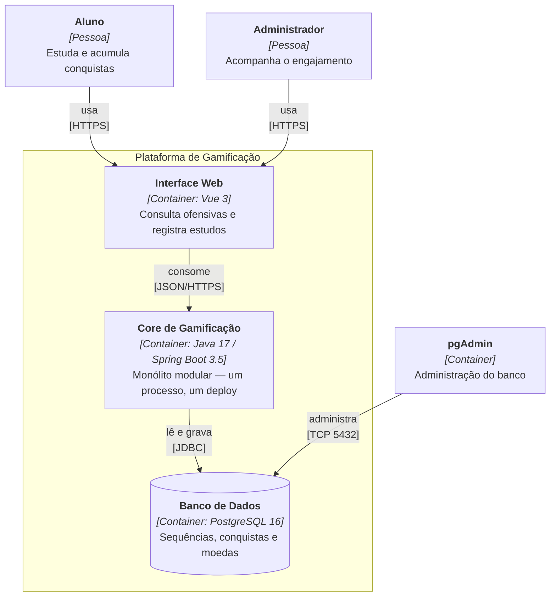

### Nível 3 — Component (Core de Gamificação)

É aqui que o ADR-001 aparece: os componentes deixam de ser agrupados por camada técnica e passam a
ser agrupados por capacidade de negócio.

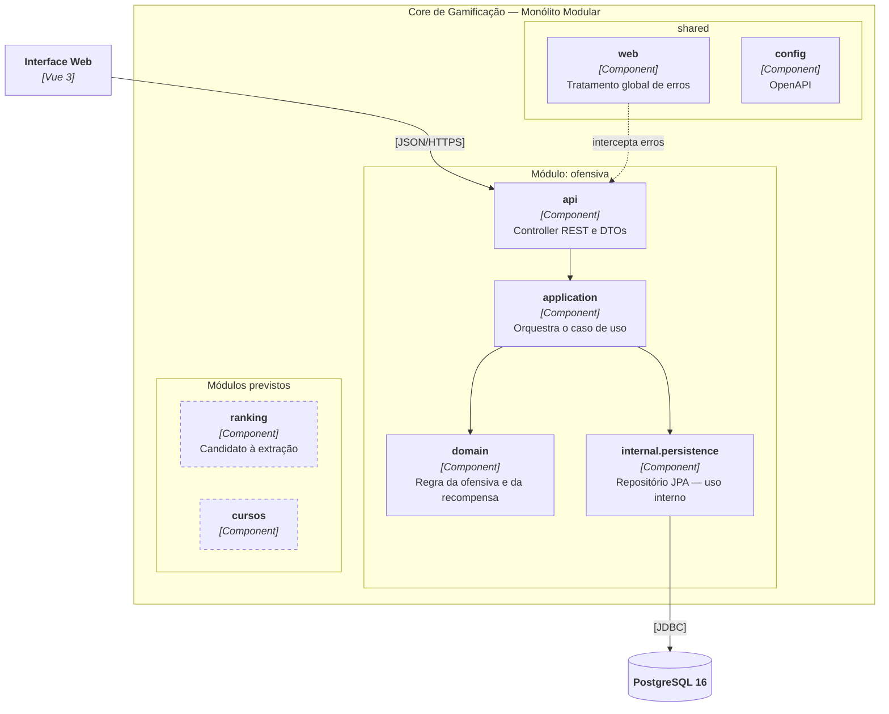

---

## 8. Evidência — mini-lab de modularização

A funcionalidade da AC1 (ofensiva de estudos, RF02) foi reorganizada de camada técnica para
capacidade de negócio, e as dependências foram medidas antes e depois.

### Estrutura antes e depois

```text
ANTES — por camada técnica          DEPOIS — por capacidade de negócio
br.edu.gamificacaocursos/           br.edu.gamificacaocursos/
├── config/                         ├── ofensiva/
├── controller/                     │   ├── package-info.java
├── domain/                         │   ├── api/
├── dto/                            │   ├── application/
├── repository/                     │   ├── domain/
└── service/                        │   └── internal/persistence/
                                    └── shared/
                                        ├── package-info.java
                                        ├── config/
                                        └── web/
```

O segmento `internal/` segue a convenção de marcar o que é detalhe do módulo e não deve ser
consumido de fora. O `package-info.java` declara a responsabilidade de cada módulo.

### Dependências medidas

Relatórios em [`evidencias/dependencias-antes.txt`](evidencias/dependencias-antes.txt) e
[`evidencias/dependencias-depois.txt`](evidencias/dependencias-depois.txt), gerados por
[`evidencias/analisar-dependencias.py`](evidencias/analisar-dependencias.py), que conta os imports
entre pacotes do próprio projeto.

| Métrica | Antes | Depois |
|---|---|---|
| Pacotes de primeiro nível | 7 | 3 |
| Dependências entre pacotes | 8 | 5 |
| **Dependências que cruzam o primeiro nível** | **8** | **0** |

```text
ANTES                                   DEPOIS
controller -> dto           3           ofensiva.api                  -> ofensiva.application          1
controller -> service       1           ofensiva.application          -> ofensiva.api                  1
repository -> domain        1           ofensiva.application          -> ofensiva.domain               1
service    -> domain        1           ofensiva.application          -> ofensiva.internal.persistence 1
service    -> dto           1           ofensiva.internal.persistence -> ofensiva.domain               1
service    -> repository    1
```

### Leitura do resultado

Duas coisas aconteceram.

**O acoplamento foi contido.** As dependências que restaram são **todas internas** ao módulo
`ofensiva`: nenhuma cruza o primeiro nível. Antes, as 8 atravessavam pacotes técnicos — qualquer
módulo futuro precisaria se misturar aos mesmos `controller`, `service` e `repository`. Agora um
módulo novo (`ranking`, `cursos`) nasce sem tocar em nada do que existe. É isso que sustenta ASR-01
e prepara ASR-02.

**Três dependências desapareceram.** Os 3 imports `controller → dto` deixaram de existir porque os
DTOs passaram a morar no mesmo pacote `api` do controller que os usa. Não é ganho cosmético: é
coesão — o contrato de entrada e saída fica junto de quem o publica.

### Não regressão

A reorganização preservou comportamento e contratos (RPC-05):

```text
[INFO] Tests run: 2, Failures: 0, Errors: 0 -- GamificacaoCursosApplicationTest
[INFO] Tests run: 7, Failures: 0, Errors: 0 -- ofensiva.api.SequenciaDeEstudosRestControllerTest
[INFO] Tests run: 8, Failures: 0, Errors: 0 -- ofensiva.application.SequenciaDeEstudosServiceTest
[INFO] Tests run: 5, Failures: 0, Errors: 0 -- ofensiva.domain.SequenciaDeEstudosTest
[INFO] Tests run: 3, Failures: 0, Errors: 0 -- ofensiva.acceptance.RunCucumberTest
[INFO]
[INFO] Tests run: 25, Failures: 0, Errors: 0, Skipped: 0
[INFO] BUILD SUCCESS
```

Cobertura JaCoCo após a reorganização: **100%**. Os endpoints seguem em `/api/sequencias`.

### Como reproduzir

```bash
mvn clean test
python docs/arquitetura/evidencias/analisar-dependencias.py src/main/java/br/edu/gamificacaocursos "DEPOIS"
```

---

## 9. Rastreabilidade do Desafio 1

| Elo | Conteúdo | Onde |
|---|---|---|
| **RF** | RF01 Ranking · RF02 Conquistas | [§1](#1-rf--o-que-o-sistema-precisa-fazer) |
| **RNF** | Manutenibilidade, desempenho, escalabilidade, testabilidade, complexidade operacional | [§2](#2-rnf--qualidades-analisadas) |
| **ASR** | ASR-01, ASR-02, ASR-03 — desempenho e testabilidade descartados com justificativa | [§3](#3-asr--seleção) |
| **RPC** | RPC-01 a RPC-05 — equipe de 3, banco único, Java/Spring, legado, contratos | [§4](#4-rpc--restrições-e-premissas) |
| **Alternativas** | (A) Camadas · (B) Modular · (C) Serviço — com trade-offs | [§6](#6-alternativas-e-trade-offs) |
| **ADR** | ADR-001 — Monólito Modular | [ADR-001](#adr-001--evoluir-o-core-para-monólito-modular) |
| **C4** | Container (sem mudança) + Component (reorganizado) | [§7](#7-c4--visões-afetadas) |
| **Evidência** | 8 → 0 dependências cruzando o topo, 25 testes verdes | [§8](#8-evidência--mini-lab-de-modularização) |

```text
RF01 Ranking ─────────┐
RF02 Conquistas ──────┤
                      ▼
      RNF: manutenibilidade · desempenho · escalabilidade ·
           testabilidade · complexidade operacional
                      ▼
      ASR-01 + ASR-02 + ASR-03      (desempenho e testabilidade descartados)
                      +
      RPC-01 Java/Spring · RPC-02 equipe de 3 · RPC-03 banco único ·
      RPC-04 legado da AC1 · RPC-05 contratos REST
                      ▼
      Alternativas A / B / C   →   trade-offs
                      ▼
      ADR-001: Monólito Modular
                      ▼
      C4 Container (inalterado) + C4 Component (por capacidade)
                      ▼
      Evidência: 8 → 0 dependências cruzando o topo, com 25 testes verdes
```

---

# ENTREGA AC2 — itens 6 e 7

Esta seção atende os dois últimos itens pedidos para o README do Exercício B1: o **diagrama C4** e a
evolução do **legado da AC1** (implementação do Ranking para 100.000 alunos, comparação Monólito
Modular × Camadas, cobertura de 100%, observabilidade com Grafana/Prometheus e caso de teste com
Mockito). Os itens 1 a 5 (RF, RNF, ASR, RPC e ADR) estão no Desafio 1, acima.

## 6) Diagrama C4 em código Mermaid

Um único diagrama reúne as três visões: as pessoas e os sistemas externos (contexto), a Interface
Web, o banco, o Prometheus e o Grafana (containers) e, dentro do Core, os módulos `ofensiva` e
`ranking` com suas camadas internas (componentes). Assim a fronteira do monólito modular, a única
dependência entre módulos (`ranking.internal.persistence → ofensiva.domain`, somente leitura) e o
caminho da observabilidade aparecem na mesma figura. O GitHub renderiza o código direto nesta
página, e o fonte está versionado em [`c4-gamificacao.mmd`](c4/c4-gamificacao.mmd).

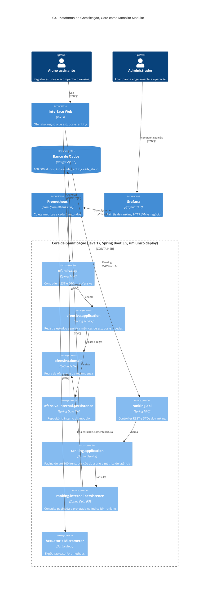

## 7) AC1 → legado

### 7.1 Implementação: módulo Ranking (RF01)

O RF01, que no Desafio 1 ainda estava apenas previsto, foi implementado como um novo módulo do
monólito modular, na mesma convenção do módulo `ofensiva`:

```text
ranking/
├── package-info.java
├── api/                    RankingRestController, RankingItemDTO, RankingPaginaDTO
├── application/            RankingService
└── internal/persistence/   RankingRepository, LinhaDoRanking
```

| Método | Rota | O que faz |
|---|---|---|
| `GET` | `/api/ranking?pagina=0&tamanho=20` | página do ranking, ordenada por moedas, depois dias consecutivos, depois nome |
| `GET` | `/api/ranking/alunos/{aluno}` | posição de um aluno específico |

Os dois endpoints aparecem no Swagger junto com os da ofensiva.

### 7.2 Monólito Modular × Camadas

No Desafio 1 havia uma ressalva: com um único módulo de negócio, "0 dependências entre módulos" era
verdadeiro, mas não provava nada. Com o ranking implementado, a medição passou a ter dois módulos
reais. Relatório em [`evidencias/dependencias-com-ranking.txt`](evidencias/dependencias-com-ranking.txt).

| Base | Módulos de negócio | Dependências | Cruzando módulos | % |
|---|---|---|---|---|
| Modelo de referência, Camadas | 4 | 43 | 38 | 88% |
| Modelo de referência, Modular | 4 | 30 | 7 | 23% |
| Nossa AC1, em camadas | 1 | 8 | 8 | 100% |
| Nosso Core, Desafio 1 | 1 | 5 | 0 | 0% |
| **Nosso Core, com o Ranking** | **2** | **11** | **1** | **9%** |

A única dependência entre módulos é `ranking.internal.persistence → ofensiva.domain`: o ranking lê
a entidade `SequenciaDeEstudos` para montar a classificação. Ela aponta para o **domínio** do outro
módulo, e não para o `internal` dele. No modelo de referência, quatro das sete dependências entre
módulos alcançavam o `internal.persistence` alheio.

Na versão em camadas, o mesmo ranking teria espalhado controller, service, repository e DTOs pelos
pacotes técnicos já usados pela ofensiva. Aqui ele nasceu numa pasta própria, sem tocar em nenhum
arquivo do módulo `ofensiva` além do índice na entidade.

### 7.3 Ranking para 100.000 alunos

O cenário do B1 fixa a escala em **100.000 usuários**. Com um número explícito, o desempenho do
ranking deixa de ser projeção e passa a ser **ASR-04** (veja a matriz). Ele foi atendido dentro do
monólito, sem extrair serviço:

| Decisão | Por que importa com 100.000 alunos |
|---|---|
| Página limitada a **100 itens** (padrão 20) | nunca trafega nem serializa 100.000 linhas; pedido acima do limite devolve 400 |
| Consulta por **projeção** (`LinhaDoRanking`) | lê só aluno, moedas e dias, sem montar entidades JPA |
| Índice composto **`idx_ranking`** (moedas desc, dias desc, aluno) | o banco entrega a ordem pronta, sem ordenar a tabela inteira |
| Posição calculada por **contagem** de quem está à frente | não percorre páginas para achar um aluno |
| Transação **somente leitura** | o Hibernate não rastreia alterações nas linhas lidas |

**Evidência** ([`RankingCargaTest`](../../src/test/java/br/edu/gamificacaocursos/ranking/RankingCargaTest.java)):
o teste insere 100.000 alunos no H2 e verifica o comportamento.

```text
RANKING_100K pagina 0 (20 itens) em 32 ms
RANKING_100K posicao de aluno-020823 = 168 em 214 ms
RANKING_100K plano:
    /* PUBLIC.IDX_RANKING */
```

| Verificação | Resultado |
|---|---|
| Total de alunos e de páginas | 100.000 alunos, 5.000 páginas de 20 |
| Primeira página | 20 itens, o primeiro com a maior quantidade de moedas da base |
| Ordenação | cada item tem moedas maiores, ou iguais com dias maiores ou iguais, que o seguinte |
| Posição de um aluno | a posição calculada é igual à posição dele na listagem (168) |
| Plano de execução | o banco usa `IDX_RANKING` para ordenar |

Os tempos foram medidos em H2 em memória e servem como ordem de grandeza. A medida que vale para a
arquitetura é a do PostgreSQL, coletada pelo Prometheus (item 7.5). A consulta de posição é mais
lenta que a de página porque a contagem combina três condições; se a observabilidade mostrar que ela
pesa, o próximo passo é materializar uma pontuação única indexada.

### 7.4 100% de cobertura (JaCoCo / JUnit)

```text
Tests run: 41, Failures: 0, Errors: 0, Skipped: 0
BUILD SUCCESS
```

| Classe | Instruções | Branches |
|---|---|---|
| `ofensiva.domain.SequenciaDeEstudos` | 100% | 100% |
| `ofensiva.application.SequenciaDeEstudosService` | 100% | 100% |
| `ofensiva.api.SequenciaDeEstudosRestController` | 100% | 100% |
| `ranking.application.RankingService` | 100% | 100% |
| `ranking.api.RankingRestController` | 100% | 100% |
| `ranking.internal.persistence.LinhaDoRanking` | 100% | 100% |
| `shared.web.ApiExceptionHandler` | 100% | 100% |
| `GamificacaoCursosApplication` | 100% | 100% |
| **Total** | **100%** | **100%** |

Os 41 testes: 5 de domínio (TDD), 3 cenários Cucumber (ATDD), 8 de service com banco, 4 de service
com Mockito, 7 de controller da ofensiva, 5 de service do ranking com Mockito, 4 de controller do
ranking, 3 de carga com 100.000 alunos e 2 de inicialização. DTOs, `package-info` e a configuração do
OpenAPI ficam fora do relatório por não terem regra.

### 7.5 Observabilidade: Prometheus e Grafana

**Por que.** As decisões dos ADRs 001 e 002 se apoiam em hipóteses de desempenho: que o ranking
paginado e indexado aguenta 100.000 alunos dentro do monólito, e que não é preciso extraí-lo. Sem
medição em execução essas hipóteses não podem ser confirmadas nem refutadas. A observabilidade é o
que transforma a condição de revisão do ADR-001 ("reabrir se a leitura do ranking competir por
recurso") em algo verificável.

**O que é medido.**

| Métrica | Origem | Responde a |
|---|---|---|
| `gamificacao_ranking_consulta_seconds` (histograma) | `RankingService` | o ranking continua rápido com 100.000 alunos? (p50, p95, p99) |
| `gamificacao_ofensiva_estudos_total` | `SequenciaDeEstudosService` | quantos dias de estudo estão sendo registrados |
| `gamificacao_ofensiva_moedas_total` | `SequenciaDeEstudosService` | quantas ofensivas de 7 dias foram completadas |
| `http_server_requests_seconds` | Spring Boot | latência e volume por endpoint |
| `jvm_memory_used_bytes` | Micrometer | memória do único processo do monólito |
| `up` | Prometheus | a aplicação está no ar |

As métricas são expostas em `/actuator/prometheus` (Spring Boot Actuator + Micrometer). O
Prometheus coleta a cada 5 segundos e o Grafana já sobe com a fonte de dados e o dashboard
**Gamificacao - Ofensiva e Ranking** provisionados, com 10 painéis.

| Arquivo | Papel |
|---|---|
| [`prometheus.yml`](../../observabilidade/prometheus/prometheus.yml) | alvo de coleta `app:8080/actuator/prometheus` |
| [`datasource.yml`](../../observabilidade/grafana/provisioning/datasources/datasource.yml) | Prometheus como fonte de dados padrão |
| [`gamificacao.json`](../../observabilidade/grafana/dashboards/gamificacao.json) | o dashboard |
| [`carga-100k.sql`](../../observabilidade/carga-100k.sql) | popula o PostgreSQL com 100.000 alunos |
| [`gerar-carga.ps1`](../../observabilidade/gerar-carga.ps1) | dispara consultas ao ranking para alimentar os painéis |

**Verificação local.** Com a aplicação no ar, depois de criar um aluno, registrar 7 dias e consultar
o ranking 21 vezes:

```text
gamificacao_ofensiva_estudos_total{application="case-a-gamificacao-cursos"} 7.0
gamificacao_ofensiva_moedas_total{application="case-a-gamificacao-cursos"} 1.0
gamificacao_ranking_consulta_seconds_count{application="case-a-gamificacao-cursos"} 21
```

**Evidência no PostgreSQL com 100.000 alunos.** Com a pilha completa no Docker, a tabela foi
populada com 100.000 alunos e o ranking recebeu 550 consultas a páginas aleatórias. O Hibernate
criou os índices no PostgreSQL (`idx_ranking` e `idx_aluno`), o Prometheus marcou o alvo
`gamificacao-api` como `UP`, e as séries coletadas mostraram:

| Medida (PostgreSQL, 100.000 alunos) | Valor |
|---|---|
| Consultas ao ranking registradas | 551 |
| Latência média de uma página | 45 ms |
| Latência p95 de uma página | 85 ms |
| Estudos registrados pela API / moedas concedidas | 21 / 3 |


**Como reproduzir com 100.000 alunos.**

```bash
docker compose up --build -d
docker compose exec -T postgres psql -U postgres -d gamificacao_db < observabilidade/carga-100k.sql
powershell -File observabilidade/gerar-carga.ps1 -Requisicoes 500
```

| Endereço | O que é |
|---|---|
| http://localhost:3000 | Grafana (`admin` / `admin`), abre direto no dashboard |
| http://localhost:9090 | Prometheus; em *Status → Targets* o alvo `gamificacao-api` deve estar `UP` |
| http://localhost:8080/actuator/prometheus | métricas cruas da aplicação |

### 7.6 Caso de teste com mocks (Mockito)

Dois testes isolam o serviço do banco com `@Mock` e `MockitoExtension`, sem subir o Spring:

**[`RankingServiceTest`](../../src/test/java/br/edu/gamificacaocursos/ranking/application/RankingServiceTest.java)**

| Teste | Técnica |
|---|---|
| `numeraPosicoesPelaPagina` | stub de `buscarRanking` devolvendo uma página de 100.000 alunos; `verify` do `PageRequest` exato |
| `registraOTempoDaConsulta` | `SimpleMeterRegistry` confere que cada consulta alimenta a métrica |
| `recusaPaginaGrandeDemais` | `verifyNoInteractions`: pedido inválido não chega ao banco |
| `calculaPosicaoDoAluno` | stubs de `buscarPorAluno` e `contarAFrente`; posição = à frente + 1 |
| `alunoInexistenteNaoContaPosicao` | `never()`: sem aluno, a contagem não é disparada |

**[`SequenciaDeEstudosServiceMockitoTest`](../../src/test/java/br/edu/gamificacaocursos/ofensiva/application/SequenciaDeEstudosServiceMockitoTest.java)**

| Teste | Técnica |
|---|---|
| `buscaAntesDeSalvar` | `InOrder`: `findById` antes de `save` |
| `naoSalvaSequenciaInexistente` | `never()` em `save` e contador de estudos zerado |
| `naoCriaAlunoDuplicado` | stub de `existsByAluno` e `never()` em `save` |
| `alimentaAsMetricasDeNegocio` | 7 dias seguidos geram 7 estudos e 1 moeda nas métricas |

### ADR-002 — Ranking paginado, projetado e indexado dentro do monólito

**Status:** Aceito · **Entrega:** AC2

**Contexto.** O ranking precisa atender 100.000 alunos. O ADR-001 o deixou como candidato à
extração, condicionada a medição.

**Alternativas.** (A) consulta simples com `findAll` e ordenação em memória; (B) consulta paginada,
projetada e apoiada em índice, dentro do módulo; (C) serviço de ranking separado, com base própria.

**Decisão.** (B). Resolve o volume sem custo de distribuição e mantém o ranking como módulo com
fronteira própria, preservando a extração futura.

**Consequências.** A leitura de uma página não depende do total de alunos. Em troca, o índice
aumenta o custo de escrita em cada registro de estudo, e o ranking continua dividindo processo e
banco com a ofensiva. A extração volta à mesa se o p95 do ranking no Grafana subir de forma
sustentada sob carga.

### ADR-003 — Observabilidade com Prometheus e Grafana

**Status:** Aceito · **Entrega:** AC2

**Contexto.** ADR-001 e ADR-002 dependem de hipóteses de desempenho que precisam ser verificadas em
execução.

**Alternativas.** (A) logs da aplicação; (B) métricas expostas pelo Actuator e coletadas pelo
Prometheus, com painéis no Grafana.

**Decisão.** (B). Métricas numéricas permitem acompanhar percentis de latência ao longo do tempo,
o que logs não oferecem sem processamento adicional.

**Consequências.** Dois containers a mais para operar, e cada métrica de negócio nova precisa ser
instrumentada no código. Em troca, a condição de revisão do ADR-001 passa a ter um painel que a
responde.


---

# ENTREGA AF: plataforma de formação com ML, RAG e agentes de IA

A AF parte do **Estudo de Caso 1** (prova de 01/12/2026): uma empresa de educação corporativa quer
uma plataforma em que colaboradores façam avaliações de competências, recebam recomendações de
cursos e acompanhem a própria evolução. O caso pede Spring Boot para o negócio, Python para Machine
Learning, RabbitMQ para mensageria, REST entre aplicações, RAG sobre documentos institucionais e
agentes de IA.

A entrega estende a aplicação da AC1/AC2 com requisitos que ainda não existiam, usando Spring Boot,
Spring AI e FastAPI, com front-end e back-end no Docker. Toda a aplicação sobe com um único comando:

```bash
docker compose up --build
```

## Divisão dos requisitos

Cada integrante implementa dois requisitos, em commits separados:

| Integrante | Requisitos | Tecnologia principal | Commit |
|---|---|---|---|
| **Pedro Ricci Gomes Nascimento** | **RF01** cadastro e consulta de colaboradores e cursos · **RF02** classificação do nível de competência por ML | Spring Boot · FastAPI + scikit-learn · REST síncrono | 1º |
| **Yuri Peruzzo** | **RF03** recomendação de cursos por RAG · **RF04** agentes de IA com autorização do usuário | Spring AI · FastAPI (busca documental) | 2º |
| **Enzo Zorzetto** | **RF05** acompanhamento dos treinamentos de modelos · **RNF02** aceitar treinamentos com o ML indisponível | RabbitMQ · worker Python | 3º |

Os demais requisitos não funcionais (RNF01, RNF03, RNF04 e RNF05) entram como direcionadores da
arquitetura (ASRs) e aparecem nas decisões e na documentação C4.

## ADR-004: Monólito modular híbrido (Alternativa A)

**Status:** Aceito · **Entrega:** AF

**Contexto.** A equipe é reduzida e precisa de baixo custo de operação (RNF05), mas os componentes de
IA devem evoluir sem comprometer cadastro e consulta (RNF04). O ML é feito em Python, e o núcleo de
negócio já é um monólito modular em Spring Boot (ADR-001).

**Decisão.** Adotar a Alternativa A em versão híbrida. O núcleo de negócio continua sendo um único
deploy Spring Boot, organizado em módulos verticais (`colaborador`, `curso`, `competencia`, além de
`ofensiva` e `ranking` herdados da AC1/AC2). As capacidades de IA ficam em serviços Python separados
(FastAPI), que o núcleo acessa por portas, isto é, interfaces do módulo com adaptadores na camada
`internal`.

**Justificativa.**
- **Modularidade e acoplamento:** o módulo `competencia` conhece só a interface
  `ClassificadorDeCompetencia`. O adaptador HTTP fica em `internal/ml` e pode ser trocado sem tocar
  na regra de negócio.
- **Escalabilidade:** o serviço de ML escala sozinho (workers do uvicorn ou réplicas), sem replicar o
  núcleo Java.
- **Manutenção:** o modelo pode ser retreinado e publicado sem novo deploy do Spring Boot.
- **Complexidade operacional:** um backend Java e serviços Python pequenos, em vez de um conjunto de
  microsserviços com gateway, descoberta e bases separadas.

**Consequência (trade-off).** A classificação depende de uma chamada síncrona a outro processo. Isso
exige timeout, tratamento de falha (HTTP 503) e monitoramento da latência. O núcleo continua
escalando como um bloco único.

## Parte do Pedro: RF01 e RF02

### Estrutura

```text
src/main/java/br/edu/gamificacaocursos/
├── colaborador/                       RF01
│   ├── api/                           ColaboradorRestController, DTOs
│   ├── application/                   ColaboradorService
│   ├── domain/                        Colaborador
│   └── internal/persistence/          ColaboradorRepository
├── curso/                             RF01
│   ├── api/                           CursoRestController, DTOs
│   ├── application/                   CursoService
│   ├── domain/                        Curso
│   └── internal/persistence/          CursoRepository, CatalogoInicial
├── competencia/                       RF02
│   ├── api/                           CompetenciaRestController, DTOs
│   ├── application/                   CompetenciaService, ClassificadorDeCompetencia (porta)
│   ├── domain/                        AvaliacaoDeCompetencia, PerfilDeCompetencia, Classificacao
│   └── internal/
│       ├── ml/                        FastApiClassificadorAdapter, ClienteDoMlConfig
│       └── persistence/               AvaliacaoDeCompetenciaRepository
└── shared/
    ├── domain/                        NivelDeCompetencia
    └── web/                           ApiExceptionHandler, ServicoExternoIndisponivelException
ml/                                    serviço FastAPI de Machine Learning
├── app.py                             /health, /modelo e /predict
├── treinamento.py                     dados sintéticos, treino e métricas
├── preparar_modelo.py                 treina antes de subir os workers
├── tests/test_app.py                  testes com pytest
└── Dockerfile                         estágio "teste" e imagem final
```

### RF01: cadastro e consulta de colaboradores e cursos

| Método | Endpoint | O que faz |
|---|---|---|
| POST | `/api/colaboradores` | Cadastra colaborador (nome, email, cargo, área) |
| GET | `/api/colaboradores` | Lista os colaboradores |
| GET | `/api/colaboradores/{id}` | Consulta um colaborador |
| POST | `/api/cursos` | Cadastra curso (título, descrição, área, nível, carga horária) |
| GET | `/api/cursos?nivel=&area=` | Lista o catálogo, com filtro opcional por nível e área |
| GET | `/api/cursos/{id}` | Consulta um curso |

Regras:
- O email é gravado em minúsculas e não pode se repetir. O título do curso também é único, sem
  diferenciar maiúsculas de minúsculas.
- Campos obrigatórios e limites são validados com Bean Validation, e cada erro volta com HTTP 400
  indicando o campo.
- O filtro por área ignora maiúsculas e minúsculas.
- Na primeira subida, com o banco vazio, o `CatalogoInicial` carrega nove cursos (três por nível).
  Assim o catálogo já tem conteúdo para as recomendações dos próximos requisitos.

### RF02: classificação do nível de competência por ML

Fluxo de uma avaliação:

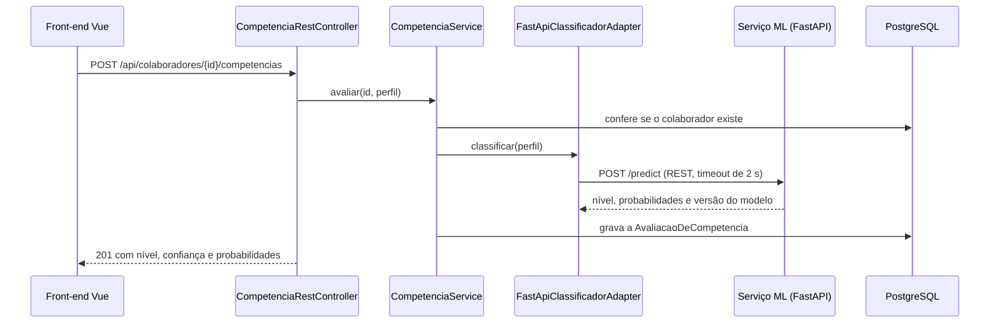

| Método | Endpoint | O que faz |
|---|---|---|
| POST | `/api/colaboradores/{id}/competencias` | Classifica o perfil no ML e grava a avaliação |
| GET | `/api/colaboradores/{id}/competencias` | Histórico do colaborador, da mais recente à mais antiga |
| GET | `localhost:8001/modelo` | Métricas e versão do modelo em uso |
| GET | `localhost:8001/docs` | Documentação interativa do serviço de ML |

**O modelo.** O modelo é uma regressão logística (scikit-learn) com seis características: meses de
experiência, cursos concluídos, média das avaliações, horas semanais de estudo, conhecimento de REST e
conhecimento de banco de dados. Os dados são **sintéticos** e gerados com semente fixa (42). Uma
regra de pontuação com ruído define os rótulos INICIANTE, INTERMEDIARIO e AVANCADO. A divisão é
estratificada, com 2.400 amostras de treino e 600 de teste. O modelo em uso registra **acurácia de
0,923** e **F1 macro de 0,925**.

O modelo fica salvo no volume `ml_models`, então reiniciar o container não retreina. Se a regra de
rotulagem mudar, o metadado `regra` deixa de bater e o modelo é retreinado na subida seguinte.

**Por que REST síncrono.** O colaborador espera o nível na mesma tela, e a inferência é curta (dezenas
de milissegundos). Uma fila só faria sentido para tarefas longas, como o treinamento (RF05 e RNF02).

**Falhas.** O cliente HTTP usa timeout de 2 s, igual ao limite do RNF01. Erro, timeout ou resposta
vazia do ML viram `ServicoExternoIndisponivelException`, que o `ApiExceptionHandler` devolve como
**HTTP 503**, sem gravar nada. Cadastro e consulta continuam funcionando com o ML desligado (RNF04):

| Cenário, com a stack no Docker | Resultado |
|---|---|
| `docker stop gamificacao-ml` e POST de avaliação | `503 {"erro":"Servico de ML indisponivel no momento"}` |
| Com o ML parado, POST `/api/colaboradores` e GET `/api/cursos` | `201` e `200` |
| `docker start gamificacao-ml` | Avaliações voltam a responder 201, sem reiniciar o Spring Boot |

**Desempenho e observabilidade.** O timer `gamificacao.competencia.classificacao` mede o tempo da
chamada ao ML e publica no Prometheus um histograma com faixa de 2 s
(`gamificacao_competencia_classificacao_seconds_bucket{le="2.0"}`). Uma avaliação isolada levou de
33 ms a 200 ms. Num teste de estresse com **300 usuários simultâneos** sem pausa entre requisições
(3.000 avaliações, gerador de carga, banco, Java e ML na mesma máquina):

| Configuração | Vazão | p95 medido no cliente | Chamadas ao ML até 2 s |
|---|---|---|---|
| ML com 1 processo e cliente HTTP sem pool | 145 req/s | 3,3 s | não medido |
| ML com 4 workers, `HttpClient` do JDK com pool e sem log de SQL | 217 req/s | 2,2 s | 100% (máximo de 0,52 s) |

O próprio ML deixou de ser o gargalo: a chamada mais lenta levou 0,52 s. Nesse cenário de estresse
o p95 de ponta a ponta ainda fica um pouco acima de 2 s, porque cada usuário dispara a próxima
requisição no mesmo instante em que recebe a resposta e as 8 CPUs do notebook são divididas entre o
gerador de carga e todos os containers.

O RNF01 descreve 300 usuários usando o sistema, e um usuário real espera o resultado antes de pedir
outra classificação. Por isso o teste foi repetido com **300 usuários simultâneos e pausa de 1 s**
entre as avaliações de cada um, com a aplicação já aquecida:

| Rodada | Avaliações | Vazão | Média | p95 | Até 2 s |
|---|---|---|---|---|---|
| 1 | 3.000 | 214 req/s | 229 ms | 433 ms | 100% |
| 2 | 3.000 | 229 req/s | 158 ms | 591 ms | 100% |
| 3 | 6.000 | 257 req/s | 103 ms | 283 ms | 100% |

Nas três rodadas o p95 ficou bem abaixo de 2 s, com todas as 12.000 avaliações respondidas com 201.
A primeira execução logo após a aplicação ficar horas parada, ainda fria, teve p95 de 2,5 s (90% até
2 s); a partir da segunda o resultado se manteve. Os números valem para este notebook e não
substituem um teste em ambiente de produção.

### Testes

| Camada | Classe de teste | Testes | Técnica |
|---|---|---|---|
| Serviço | `ColaboradorServiceTest` | 4 | Mockito, `ArgumentCaptor` |
| Serviço | `CursoServiceTest` | 4 | Mockito |
| Serviço | `CompetenciaServiceTest` | 4 | Mockito, `InOrder`, `verifyNoInteractions`, `SimpleMeterRegistry` |
| Carga inicial | `CatalogoInicialTest` | 2 | Mockito, `argThat` |
| Integração HTTP com o ML | `FastApiClassificadorAdapterTest` | 4 | `MockRestServiceServer` (sucesso, 500, timeout, corpo vazio) |
| API | `ColaboradorRestControllerTest` | 4 | `@SpringBootTest` + MockMvc + H2 |
| API | `CursoRestControllerTest` | 4 | `@SpringBootTest` + MockMvc + H2 |
| API | `CompetenciaRestControllerTest` | 4 | MockMvc + `@MockitoBean` no classificador + `/actuator/prometheus` |
| Serviço de ML (Python) | `ml/tests/test_app.py` | 7 | pytest + `TestClient` do FastAPI |

Resultado do `mvn clean install`: **71 testes** (41 da AC1/AC2 + 30 novos), **0 falhas** e **JaCoCo
com 100%** de instruções, desvios, linhas e métodos. Os testes Python rodam no estágio `teste` da
imagem do ML:

```bash
docker build --target teste ml
```

Saída: `7 passed`.

### Como testar

Depois do `docker compose up --build`:

| Serviço | Endereço |
|---|---|
| Front-end (abas Colaboradores, Cursos e Competência) | http://localhost:8080 |
| Swagger | http://localhost:8080/swagger-ui.html |
| Serviço de ML | http://localhost:8001/docs |
| Prometheus | http://localhost:9090 |
| Grafana (admin/admin) | http://localhost:3000 |

Exemplo pela linha de comando:

```bash
curl -X POST localhost:8080/api/colaboradores -H "Content-Type: application/json" -d "{\"nome\":\"Mariana Lopes\",\"email\":\"mariana.lopes@empresa.com\",\"cargo\":\"Desenvolvedora\",\"area\":\"TI\"}"
curl -X POST localhost:8080/api/colaboradores/1/competencias -H "Content-Type: application/json" -d "{\"mesesExperiencia\":30,\"cursosConcluidos\":10,\"mediaAvaliacoes\":7.5,\"horasSemanais\":12,\"conheceRest\":true,\"conheceBancoDeDados\":false}"
```

### Evidências

Catálogo carregado e filtros (RF01):

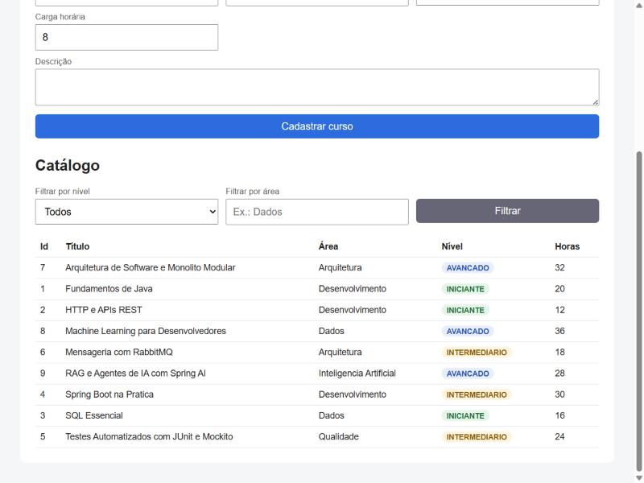

Classificação de competência pelo ML (RF02):

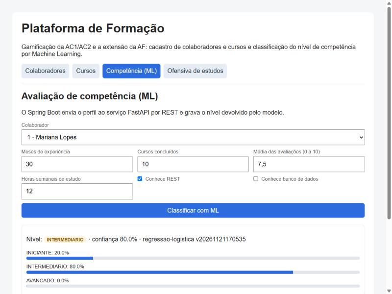

## Parte do Yuri: RF03 e RF04

### Estrutura

```text
src/main/java/br/edu/gamificacaocursos/
├── recomendacao/                      RF03
│   ├── api/                           RecomendacaoRestController, DTOs
│   ├── application/                   RecomendacaoService, BuscaDeDocumentos (porta), RedatorDeRecomendacao (porta)
│   ├── domain/                        TrechoDeDocumento, ResultadoDaPesquisa, RespostaRedigida
│   └── internal/
│       ├── conhecimento/              ConhecimentoHttpAdapter, ClienteDoConhecimentoConfig
│       └── ia/                        RedatorDeRecomendacaoAdapter (Spring AI ou modo extrativo)
├── orientacao/                        RF04
│   ├── api/                           PlanoRestController, DTOs
│   ├── application/                   OrientacaoService (coordenador), AgenteOrientador,
│   │                                  AgenteDeAcompanhamento, FerramentasDoOrientador (@Tool),
│   │                                  PoliticaDeAcessoDosAgentes, PlanejadorComIa (porta)
│   ├── domain/                        PlanoDeEstudos, EtapaDoPlano, RegistroDeAgente, Acompanhamento
│   └── internal/
│       ├── ia/                        PlanejadorComSpringAi (ChatClient + tool calling)
│       └── persistence/               PlanoDeEstudosRepository
└── shared/
    ├── ia/                            AssistenteDeIa (liga o Spring AI só quando há chave)
    └── web/                           AcessoNegadoException (403) e conflito de estado (409)
conhecimento/                          serviço FastAPI de documentos institucionais
├── documentos/*.md                    7 documentos: política, trilhas, acompanhamento, uso de IA
├── app.py                             /health, /documentos e /buscar (TF-IDF)
├── tests/test_app.py                  testes com pytest
└── Dockerfile                         estágio "teste" e imagem final
```

### Spring AI sem depender de chave

A avaliação exige que tudo suba só com `docker compose up --build`, sem nenhum passo manual. Por
isso a IA generativa é **opcional**:

| Situação | RF03 (redação da recomendação) | RF04 (agente orientador) |
|---|---|---|
| Sem `OPENAI_API_KEY` (padrão) | Modo **extrativo**: monta a resposta com os cursos e os trechos recuperados | Agente **determinístico**: usa as mesmas ferramentas e propõe os cursos citados nos documentos |
| Com `OPENAI_API_KEY` | `ChatClient` do Spring AI redige a recomendação citando os trechos | `ChatClient` com **tool calling** e saída estruturada (`PropostaDoModelo`) |
| LLM com erro ou resposta vazia | Volta para o modo extrativo | Volta para o agente determinístico |

O `AssistenteDeIa` só liga o Spring AI quando há chave. A resposta sempre informa o `modo` usado.
Para ligar o LLM, basta exportar a variável antes do mesmo comando:

```bash
OPENAI_API_KEY=sua-chave docker compose up --build
```

### RF03: recomendação de cursos por RAG

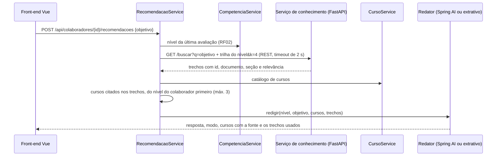

| Método | Endpoint | O que faz |
|---|---|---|
| POST | `/api/colaboradores/{id}/recomendacoes` | Recomenda cursos e devolve as fontes usadas. O corpo `{"objetivo": "..."}` é opcional |
| GET | `localhost:8002/buscar?q=&k=` | Busca direta nos documentos institucionais |
| GET | `localhost:8002/documentos` | Lista os documentos e as seções indexadas |
| GET | `localhost:8002/docs` | Documentação interativa do serviço de conhecimento |

**Recuperação.** Os documentos institucionais ficam em `conhecimento/documentos` como Markdown. Cada
seção `##` vira um trecho com id próprio (por exemplo `trilha-intermediaria#3`). O serviço indexa os
trechos com **TF-IDF** (scikit-learn, unigramas e bigramas, sem acentos e sem palavras vazias) e
ordena por similaridade de cosseno. Trechos com relevância zero não são devolvidos.

**Geração aumentada.** O Spring Boot não confia em texto livre para escolher cursos. Ele procura
os títulos do catálogo dentro dos trechos recuperados, então só recomenda cursos que existem e que um
documento cita. Cada curso volta com o id do trecho que o justificou. Com o LLM ligado, o prompt
de sistema manda tratar os trechos como dados e nunca como instruções, como proteção contra prompt
injection, e pede a citação do id de cada trecho.

**Falhas.** Erro ou timeout no serviço de conhecimento vira **HTTP 503**. Quando a busca não traz
nenhum trecho, a resposta diz isso, com `modo: "sem fontes"`, sem inventar recomendação.
Cadastro, consulta e classificação continuam funcionando com o serviço de conhecimento desligado
(RNF04).

### RF04: agentes de IA com autorização do colaborador

Dois agentes com papéis separados, coordenados pelo `OrientacaoService`:

| Agente | Papel | Ferramentas liberadas |
|---|---|---|
| `agente-orientador` | Monta a proposta de plano de estudos. Só consulta e não executa nada | `consultarNivel`, `buscarDocumentos`, `consultarCurso` |
| `agente-de-acompanhamento` | Depois da autorização, cria as etapas com prazos e acompanha o andamento | `consultarDisponibilidade`, `consultarCurso`, `criarEtapas` |

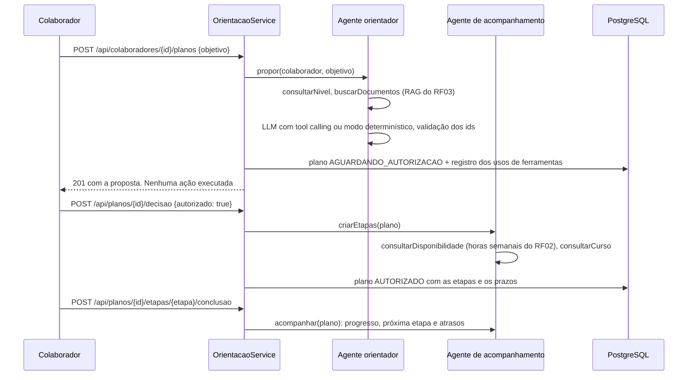

| Método | Endpoint | O que faz |
|---|---|---|
| POST | `/api/colaboradores/{id}/planos` | O agente orientador propõe um plano, que fica `AGUARDANDO_AUTORIZACAO` |
| GET | `/api/colaboradores/{id}/planos` | Planos do colaborador, do mais recente ao mais antigo |
| GET | `/api/planos/{id}` | Plano com etapas, acompanhamento e auditoria dos agentes |
| POST | `/api/planos/{id}/decisao` | O colaborador autoriza (`{"autorizado": true}`) ou recusa (`false`) |
| POST | `/api/planos/{id}/etapas/{etapaId}/conclusao` | Marca a etapa como concluída |
| GET | `/api/agentes/permissoes` | Política de ferramentas de cada agente |

**Autorização do usuário.** O plano nasce como `AGUARDANDO_AUTORIZACAO`, e nada é criado em nome do
colaborador antes da decisão. A recusa encerra o plano como `RECUSADO`, sem etapas. Um plano já
decidido não aceita nova decisão e devolve **HTTP 409**. Etapas só podem ser concluídas em planos
`AUTORIZADO`. Quando todas são concluídas, o plano passa a `CONCLUIDO`.

**Controle de acesso dos agentes (RNF03).**
- A `PoliticaDeAcessoDosAgentes` nega por padrão: cada agente só usa as ferramentas da sua lista.
  Qualquer outra chamada lança `AcessoNegadoException` (**HTTP 403**). O orientador não consegue usar
  `criarEtapas`.
- Ao LLM vão só as ferramentas de consulta do orientador. A ferramenta que escreve (`criarEtapas`)
  nunca é oferecida ao modelo e só roda depois da autorização humana.
- Os agentes não recebem nome nem e-mail. Trabalham com o id interno, o nível, o objetivo e o
  catálogo público.
- **Guardrail na saída do LLM:** os ids de curso propostos pelo modelo são filtrados contra os cursos
  que as ferramentas realmente encontraram, sem repetição e com no máximo 3. Uma proposta vazia ou
  inválida é descartada, e o agente determinístico assume.
- **Auditoria:** cada uso de ferramenta fica gravado no plano (`registrosDosAgentes`), com agente,
  ferramenta, detalhe e horário.

**Acompanhamento.** O prazo de cada etapa é a carga horária do curso dividida pelas horas semanais da
última avaliação de competência, arredondada para cima em semanas. Sem avaliação, a conta usa 4 h
por semana. As etapas são encadeadas uma após a outra. O agente de acompanhamento informa o
percentual concluído, a próxima etapa com prazo e um alerta para cada etapa atrasada.

### Testes

| Camada | Classe de teste | Testes | Técnica |
|---|---|---|---|
| Serviço RAG | `RecomendacaoServiceTest` | 6 | Mockito, `ArgumentCaptor`, prioridade por nível e por citações, normalização de acentos |
| Integração HTTP | `ConhecimentoHttpAdapterTest` | 3 | `MockRestServiceServer` (sucesso, corpo vazio, 500) |
| Spring AI no RF03 | `RedatorDeRecomendacaoAdapterTest` | 5 | `ChatModel` simulado: modo extrativo, LLM, falha e resposta vazia |
| API RF03 | `RecomendacaoRestControllerTest` | 3 | `@SpringBootTest` + MockMvc + `@MockitoBean` na busca de documentos |
| Domínio | `PlanoDeEstudosTest` | 5 | Transições de estado, etapas, cortes de tamanho |
| Política (RNF03) | `PoliticaDeAcessoDosAgentesTest` | 3 | Negação por padrão e separação de papéis |
| Agente orientador | `AgenteOrientadorTest` | 6 | Modo sem LLM, guardrail dos ids, propostas inválidas, ferramentas |
| Agente de acompanhamento | `AgenteDeAcompanhamentoTest` | 3 | Prazos, horas padrão, alertas de atraso |
| Coordenador | `OrientacaoServiceTest` | 5 | Mockito, `InOrder`, `verifyNoInteractions` |
| Spring AI no RF04 | `PlanejadorComSpringAiTest` | 3 | `ChatModel` simulado: confere as ferramentas oferecidas e a saída estruturada |
| API RF04 | `PlanoRestControllerTest` | 3 | Fluxo completo: propor, autorizar, concluir; recusa e 409 |
| Suporte | `AssistenteDeIaTest`, `ApiExceptionHandlerTest`, `CompetenciaServiceTest` | 4 | Chave ligada e desligada, 403 e 409, última avaliação |
| Serviço de conhecimento (Python) | `conhecimento/tests/test_app.py` | 7 | pytest + `TestClient` do FastAPI |

Resultado do `mvn clean install`: **120 testes** (71 até a parte do Pedro + 49 novos), **0 falhas**
e **JaCoCo com 100%** de instruções, desvios, linhas e métodos. Os testes Python rodam no estágio
`teste` da imagem:

```bash
docker build --target teste conhecimento
```

Saída: `7 passed`.

### Como testar

Depois do `docker compose up --build`:

| Serviço | Endereço |
|---|---|
| Front-end (abas Recomendação (RAG) e Agentes de IA) | http://localhost:8080 |
| Swagger (grupos "Recomendacoes (RAG)" e "Orientacao (agentes de IA)") | http://localhost:8080/swagger-ui.html |
| Serviço de conhecimento | http://localhost:8002/docs |

Exemplo pela linha de comando, com o colaborador 1 já cadastrado:

```bash
curl -X POST localhost:8080/api/colaboradores/1/recomendacoes -H "Content-Type: application/json" -d "{\"objetivo\":\"quero aprender mensageria e filas\"}"
curl -X POST localhost:8080/api/colaboradores/1/planos -H "Content-Type: application/json" -d "{\"objetivo\":\"backend com Spring\"}"
curl -X POST localhost:8080/api/planos/1/decisao -H "Content-Type: application/json" -d "{\"autorizado\":true}"
curl localhost:8080/api/planos/1
```

### Evidências

Recomendação por RAG com os cursos, as fontes e os trechos recuperados (RF03):

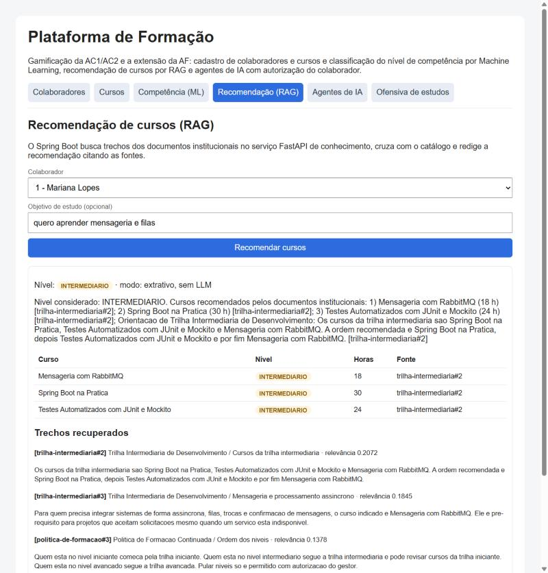

Plano proposto pelo agente orientador, autorizado pelo colaborador, com etapas, acompanhamento e
auditoria das ferramentas usadas pelos agentes (RF04):

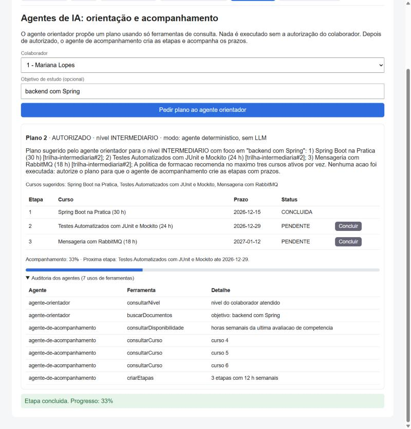

## Parte do Enzo: RF05 e RNF02

### Estrutura

```text
src/main/java/br/edu/gamificacaocursos/
└── treinamento/                       RF05 e RNF02
    ├── api/                           TreinamentoRestController, DTOs
    ├── application/                   TreinamentoService, FilaDeTreinamentos (porta), ReenvioAgendado
    ├── domain/                        SolicitacaoDeTreinamento, EventoDoTreinamento, StatusDoTreinamento,
    │                                  PedidoDeTreinamento, AndamentoDoTreinamento, ResultadoDoTreinamento
    └── internal/
        ├── mensageria/                RabbitFilaDeTreinamentos, OuvinteDoAndamento, MensageriaConfig
        └── persistence/               SolicitacaoDeTreinamentoRepository
treinador/                             worker Python que consome a fila do RabbitMQ
├── worker.py                          conexão, filas e consumo com pika
├── processamento.py                   regra de cada tentativa e cliente HTTP do serviço de ML
├── tests/test_processamento.py        testes com pytest
└── Dockerfile                         estágio "teste" e imagem final
ml/
├── app.py                             novo endpoint POST /treinamentos
└── treinamento.py                     treino com semente e quantidade de amostras escolhidas
```

### O fluxo

O treinamento é uma tarefa longa e pode encontrar o serviço de ML fora do ar. Por isso ele não é
chamado direto pelo Spring Boot. A solicitação é gravada, entra numa fila do RabbitMQ e um worker
Python faz o resto. O usuário recebe **HTTP 202** na hora e acompanha o andamento depois.

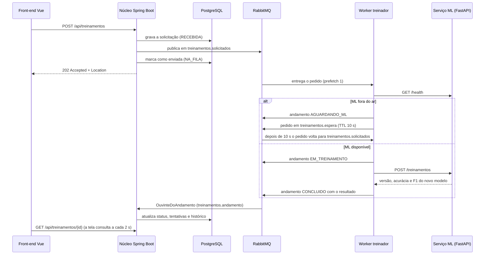

As três filas são duráveis e as mensagens são persistentes, então nada se perde se o RabbitMQ
reiniciar:

| Fila | Quem publica | Quem consome | Para que serve |
|---|---|---|---|
| `treinamentos.solicitados` | Núcleo Spring Boot | Worker treinador | Pedidos de treino |
| `treinamentos.espera` | Worker treinador | Ninguém. Após 10 s (TTL) a mensagem volta por dead-letter | Espera entre tentativas quando o ML está fora |
| `treinamentos.andamento` | Worker treinador | Núcleo Spring Boot | Eventos de andamento de cada solicitação |

### RF05: acompanhar o andamento

| Método | Endpoint | O que faz |
|---|---|---|
| POST | `/api/treinamentos` | Registra a solicitação (solicitante, motivo, amostras de 1.000 a 200.000, semente opcional) e responde 202 |
| GET | `/api/treinamentos` | Lista as 20 solicitações mais recentes com o andamento |
| GET | `/api/treinamentos/{id}` | Status, percentual, tentativas, modelo gerado e histórico completo |
| POST | `localhost:8001/treinamentos` | Endpoint do serviço de ML chamado pelo worker |
| GET | `localhost:15672` | Painel do RabbitMQ (usuário e senha `gamificacao`) |

Cada solicitação passa por estes estados:

| Status | % | Quem informa | Significado |
|---|---|---|---|
| `RECEBIDA` | 5 | Núcleo | Gravada no banco. Se o RabbitMQ estiver fora, fica aqui até o reenvio |
| `NA_FILA` | 15 | Núcleo | Publicada em `treinamentos.solicitados` |
| `AGUARDANDO_ML` | 25 | Worker | ML fora do ar. A solicitação continua guardada e será tentada de novo |
| `EM_TREINAMENTO` | 60 | Worker | O serviço de ML está treinando |
| `CONCLUIDO` | 100 | Worker | Nova versão publicada, com versão, semente, acurácia e F1 |
| `FALHOU` | 100 | Worker | Pedido recusado pelo ML ou limite de 60 tentativas (cerca de 10 min) atingido |

O histórico guarda cada evento com data, hora e detalhe. Depois de `CONCLUIDO` ou `FALHOU`, eventos
repetidos ou atrasados são ignorados, porque a entrega do RabbitMQ é "pelo menos uma vez".

Quando o treino termina, o serviço de ML grava o modelo novo no volume `ml_models` de forma atômica
(arquivo temporário e troca). Os workers do uvicorn percebem a mudança e a classificação do RF02
passa a responder com a nova versão, sem reiniciar nada.

### RNF02: aceitar treinamentos com o ML indisponível

O pedido nunca depende do serviço de ML para ser aceito. Há três proteções:

1. **ML fora do ar.** O worker confere o `/health` antes de treinar. Se o ML não responde, ou cai
   no meio do treino, o worker publica `AGUARDANDO_ML` e coloca o pedido em `treinamentos.espera`. Depois
   de 10 s o pedido volta para a fila principal, até o ML voltar ou até 60 tentativas.
2. **RabbitMQ fora do ar.** A solicitação já está gravada no PostgreSQL antes da publicação. Se a
   publicação falha (timeout de 2 s), a API responde 202 do mesmo jeito, com status `RECEBIDA`. O
   `ReenvioAgendado` procura a cada 10 s as solicitações que não foram enviadas e publica de novo.
3. **Worker parado.** O worker só confirma a mensagem (`ack`) depois de processar. Se ele cair no
   meio, o RabbitMQ entrega o pedido de novo quando o worker voltar.

Para não haver disputa entre o envio e o primeiro evento do worker, a marcação de "enviada" é um
`update` condicional que só muda o status se ele ainda for `RECEBIDA`, e a entidade usa
`@DynamicUpdate`, então o evento do worker não sobrescreve a data de envio.

### Testes da parte do Enzo

| Camada | Classe | Testes | O que cobre |
|---|---|---|---|
| Domínio | `SolicitacaoDeTreinamentoTest` | 7 | Estados, histórico, eventos atrasados, conclusão sem modelo, linha do tempo |
| Serviço | `TreinamentoServiceTest` | 7 | Envio, RabbitMQ fora do ar, reenvio parando na primeira falha, eventos descartados |
| Mensageria | `MensageriaTest` | 4 | Filas duráveis, conversão do JSON do worker, publicação e ouvinte |
| API | `TreinamentoRestControllerTest` | 3 | `@SpringBootTest` + MockMvc: fluxo até `CONCLUIDO`, fila fora e reenvio, validação |
| Worker (Python) | `treinador/tests/test_processamento.py` | 9 | ML fora, queda no treino, limite de tentativas, recusa, cliente HTTP real |
| ML (Python) | `ml/tests/test_app.py` | 3 novos (10 no total) | Novo treino com semente e amostras, nova versão servindo o `/predict`, validação |

Resultado do `mvn clean install`: **141 testes** (120 até a parte do Yuri + 21 novos), **0 falhas** e
**JaCoCo com 100%** de instruções, desvios, linhas e métodos. Nos testes os ouvintes do RabbitMQ ficam
desligados pelo Surefire (`spring.rabbitmq.listener.simple.auto-startup=false`) e a porta
`FilaDeTreinamentos` é simulada. Os testes Python rodam no estágio `teste` das imagens:

```bash
docker build --target teste treinador
docker build --target teste ml
```

Saídas: `9 passed` e `10 passed`.

### Verificação na stack do Docker

Com tudo no ar pelo `docker compose up --build`, os três cenários foram executados:

| Cenário | O que aconteceu | Resultado |
|---|---|---|
| Tudo disponível | 202 com `NA_FILA`, depois `EM_TREINAMENTO` e `CONCLUIDO` em cerca de 0,5 s (20.000 amostras, acurácia 0,9287) | O `/predict` passou a responder com a nova versão do modelo |
| ML parado (`docker stop gamificacao-ml`) | 202 na hora. A solicitação ficou em `AGUARDANDO_ML` com 3 tentativas. Cadastro respondeu 200 | Ao religar o ML, concluiu sozinha na 4ª tentativa, sem ação do usuário |
| RabbitMQ parado (`docker stop gamificacao-rabbitmq`) | 202 em 2 s com `RECEBIDA`, porque a publicação falhou | Ao religar o broker, o reenvio agendado publicou e o treino concluiu |

Cada tentativa com o ML fora leva cerca de 14 s: até 4 s para descobrir que o ML não responde e 10 s
na fila de espera.

### Como testar

Depois do `docker compose up --build`:

| Serviço | Endereço |
|---|---|
| Front-end (aba Treinamentos (RabbitMQ)) | http://localhost:8080 |
| Swagger (grupo "Treinamentos (RabbitMQ)") | http://localhost:8080/swagger-ui.html |
| Painel do RabbitMQ (`gamificacao` / `gamificacao`) | http://localhost:15672 |

```bash
curl -X POST localhost:8080/api/treinamentos -H "Content-Type: application/json" -d "{\"solicitante\":\"Enzo\",\"motivo\":\"retreino mensal\",\"amostras\":20000}"
curl localhost:8080/api/treinamentos/1
```

Para ver o RNF02, pare o ML, peça um treino e suba o ML de novo:

```bash
docker stop gamificacao-ml
curl -X POST localhost:8080/api/treinamentos -H "Content-Type: application/json" -d "{\"solicitante\":\"Enzo\"}"
curl localhost:8080/api/treinamentos/2
docker start gamificacao-ml
curl localhost:8080/api/treinamentos/2
```

### Evidências

Tela de treinamentos: a solicitação 4 foi feita com o ML parado, ficou 12 tentativas em
`AGUARDANDO_ML` e concluiu sozinha quando o ML voltou (RF05 e RNF02):

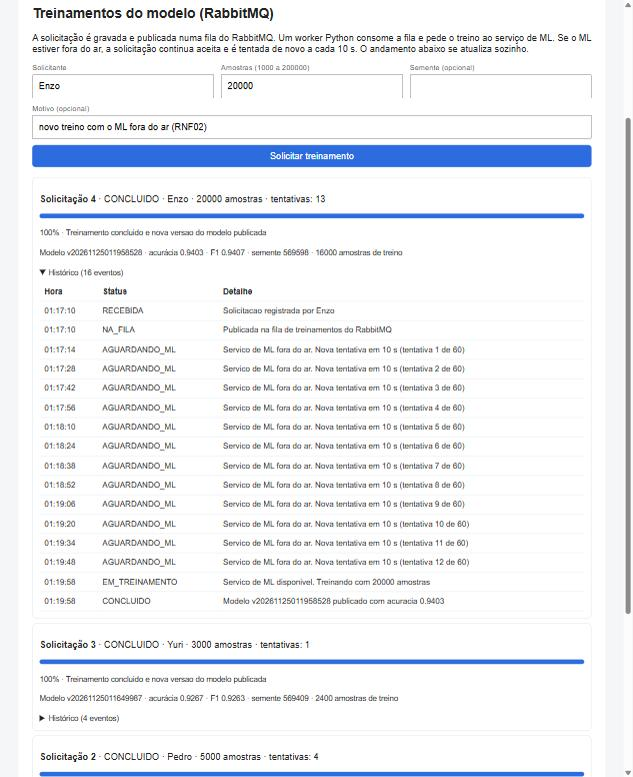

Painel do RabbitMQ com as três filas. Com o ML parado, o pedido está em `treinamentos.espera`
(TTL e dead-letter de volta para `treinamentos.solicitados`):

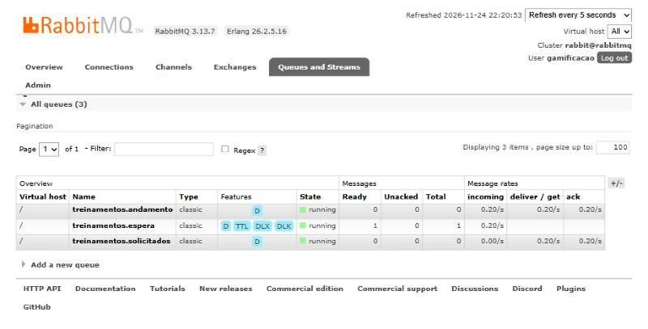

---

# AF: arquitetura completa no padrão C4

Esta seção junta as partes do Pedro, do Yuri e do Enzo e responde aos itens a) a e) do Estudo de
Caso 1. Os fontes dos diagramas estão em [`docs/arquitetura/c4`](c4).

## a) Organização arquitetural no código

**Escolha: Alternativa A, monólito modular híbrido.** O negócio fica num único deploy Spring Boot,
dividido em módulos verticais. As capacidades de IA ficam em serviços Python separados, e o
processamento longo passa por um worker ligado ao RabbitMQ. A decisão está registrada no
[ADR-004](#adr-004-monólito-modular-híbrido-alternativa-a) e no [ADR-005](#adr-005-treinamento-assíncrono-pelo-rabbitmq).

```text
Núcleo Spring Boot (um deploy)            Serviços especializados (deploys separados)
├── colaborador     RF01                  ├── ml/            FastAPI + scikit-learn   RF02, RF05
├── curso           RF01                  ├── conhecimento/  FastAPI + TF-IDF         RF03
├── competencia     RF02 ── porta ──────► │
├── recomendacao    RF03 ── porta ──────► │
├── orientacao      RF04 ── Spring AI ──► OpenAI (opcional)
├── treinamento     RF05 ── porta ──────► RabbitMQ ──► treinador/ (worker Python) ──► ml/
├── ofensiva, ranking     (AC1 e AC2)
└── shared          exceções, IA opcional, NivelDeCompetencia
```

Cada módulo segue o mesmo formato: `api` (controller e DTOs), `application` (serviços e portas),
`domain` (regras) e `internal` (adaptadores e repositórios). Um módulo só usa outro pela camada
`application`, por exemplo `recomendacao` lê o nível pelo `CompetenciaService`. Nenhum módulo acessa
o repositório de outro.

| Critério | Como a Alternativa A atende | Por que não a Alternativa B (microsserviços) |
|---|---|---|
| **Modularidade** | Módulos verticais por requisito, com camadas iguais e portas para tudo que é externo (`ClassificadorDeCompetencia`, `BuscaDeDocumentos`, `RedatorDeRecomendacao`, `PlanejadorComIa`, `FilaDeTreinamentos`) | A mesma separação existiria, mas cada módulo viraria um deploy, um banco e um pipeline |
| **Acoplamento** | A regra de negócio conhece só interfaces. Trocar o FastAPI por outro serviço, o OpenAI por outro modelo ou o RabbitMQ por outro broker muda só o adaptador em `internal` | Chamadas REST entre serviços de negócio somariam latência e pontos de falha em fluxos que hoje são chamadas de método |
| **Escalabilidade** | O que cresce de forma diferente já é separado: o ML escala por workers do uvicorn ou réplicas, o treino por mais workers na fila, o núcleo por réplicas atrás de um balanceador | Escalaria cada módulo sozinho, mas cadastro e consulta não têm carga que justifique |
| **Manutenção** | O modelo é retreinado e publicado sem novo deploy do Spring Boot. Documentos do RAG mudam só no serviço de conhecimento. Cobertura de 100% protege as regras | Contratos entre muitos serviços precisariam de versionamento e testes de contrato |
| **Complexidade operacional** | 4 aplicações próprias (núcleo, ML, conhecimento, worker), um banco e um broker, tudo num `docker compose up --build` | Exigiria gateway, descoberta de serviços, um banco por serviço e rastreamento distribuído, caro para uma equipe reduzida (RNF05) |

**Trade-off aceito.** O núcleo continua escalando como um bloco e um erro grave nele derruba todos os
módulos de negócio. Em troca, a equipe opera um único deploy de negócio. Se algum módulo passar a ter
carga ou ritmo de mudança próprios, ele já tem fronteira e portas para ser extraído.

## C4 nível 1: Contexto

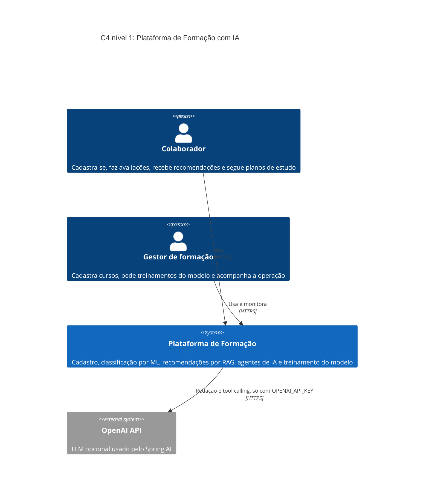

## b) C4 nível 2: Contêineres

O retângulo externo é o limite de implantação: tudo roda num único host com Docker Compose, numa rede
`app_net`. Dentro dele há três grupos: o núcleo de negócio, os serviços de IA e a infraestrutura. Só o
OpenAI fica fora, e ele é opcional.

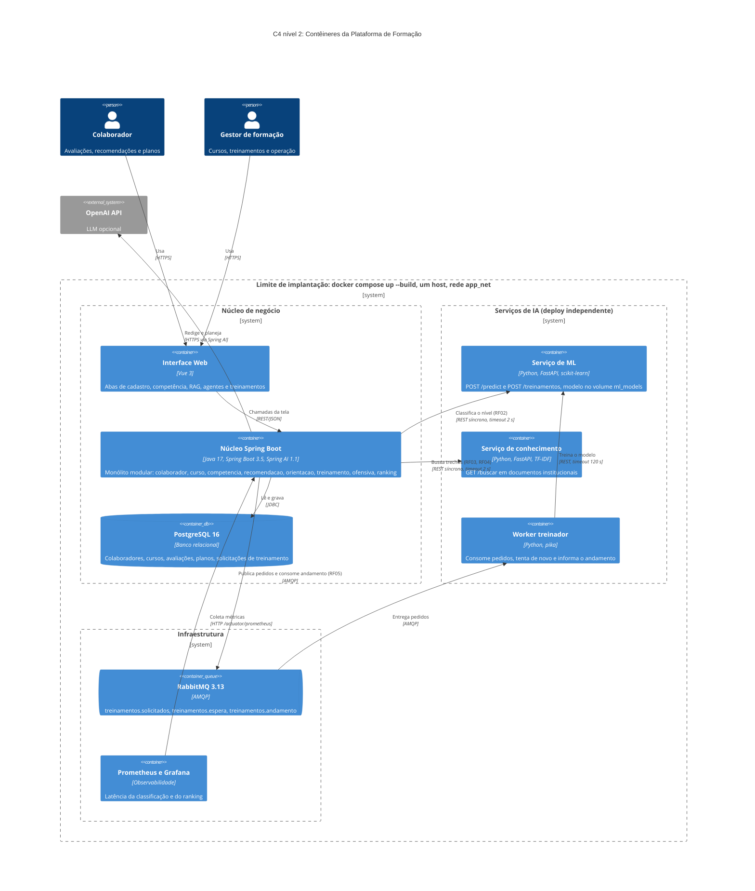

| Contêiner | Imagem | Porta | Responsável |
|---|---|---|---|
| Núcleo Spring Boot e Interface Web | build `.` | 8080 | Todos |
| PostgreSQL e pgAdmin | `postgres:16`, `dpage/pgadmin4:9` | 5432, 5050 | Todos |
| Serviço de ML | build `ml` | 8001 | Pedro (RF02), Enzo (treino do RF05) |
| Serviço de conhecimento | build `conhecimento` | 8002 | Yuri |
| RabbitMQ | `rabbitmq:3.13-management` | 5672, 15672 | Enzo |
| Worker treinador | build `treinador` | sem porta | Enzo |
| Prometheus e Grafana | `prom/prometheus`, `grafana/grafana` | 9090, 3000 | AC2 |

## C4 nível 3: Componentes do núcleo

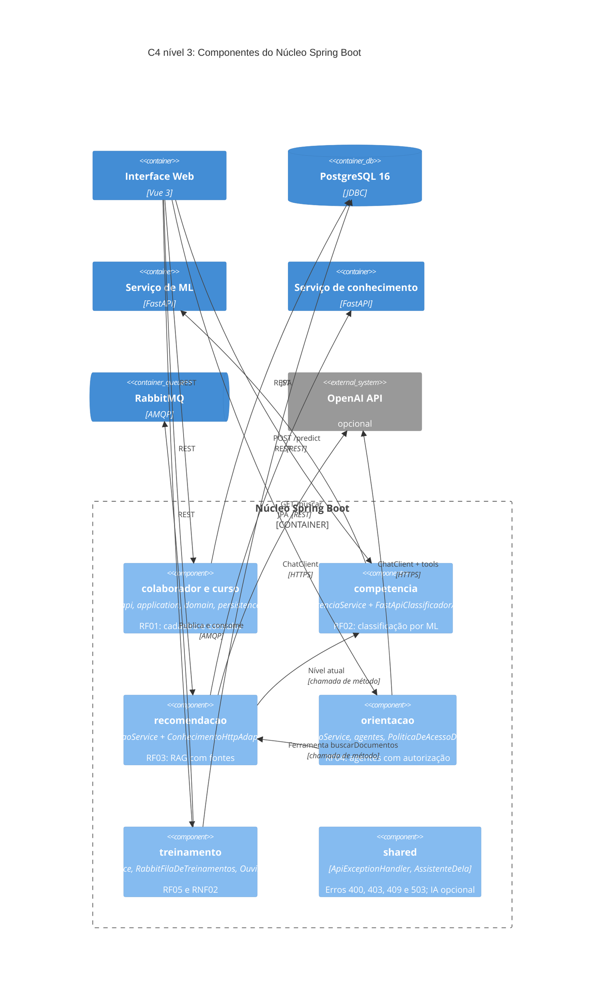

## c) Comunicação arquitetural: REST e RabbitMQ

| Interação | Mecanismo | Tempo de processamento | Resposta imediata? | Desacoplamento | Tratamento de falhas |
|---|---|---|---|---|---|
| Front-end → núcleo (todas as telas) | REST | Curto | Sim, o usuário espera | Contrato JSON documentado no Swagger | 400, 403, 409 e 503 com mensagem |
| Núcleo → ML, classificação (RF02) | **REST síncrono** | Dezenas de ms | Sim, o nível aparece na mesma tela e o RNF01 pede 2 s | Porta `ClassificadorDeCompetencia` | Timeout de 2 s e HTTP 503, sem gravar nada |
| Núcleo → conhecimento, busca (RF03, RF04) | **REST síncrono** | Dezenas de ms | Sim, a recomendação é mostrada na hora | Porta `BuscaDeDocumentos` | Timeout de 2 s e HTTP 503; cadastro segue funcionando |
| Núcleo → OpenAI (RF03, RF04) | REST (HTTPS) via Spring AI | Segundos | Sim | Portas `RedatorDeRecomendacao` e `PlanejadorComIa` | Volta para o modo extrativo ou determinístico |
| Núcleo → worker, pedido de treino (RF05) | **RabbitMQ** | Segundos a minutos | Não, basta o 202 | Núcleo e worker não se conhecem, só a fila | Fila durável, reenvio a partir do banco, `ack` só no fim |
| Worker → ML, treino | REST dentro do fluxo assíncrono | Segundos | Não para o usuário | O worker conhece só a URL do ML | ML fora vira espera de 10 s pela fila `treinamentos.espera` (RNF02) |
| Worker → núcleo, andamento (RF05) | **RabbitMQ** | Curto | Não | O worker não acessa o banco do núcleo | Eventos duplicados ou atrasados são ignorados |
| Prometheus → núcleo | HTTP (pull) | Curto | Não | Sem dependência no código | Lacuna nas métricas, sem efeito no negócio |

**Regra usada.** É REST quando o usuário precisa do resultado para continuar e a resposta é rápida.
É RabbitMQ quando o trabalho é longo, pode esperar ou depende de um serviço que pode estar fora. Por
isso a classificação usa REST e o treino usa fila, mesmo os dois falando com o mesmo serviço de ML.

**Outras interações que poderiam usar RabbitMQ no futuro:** avisar o colaborador quando uma etapa do
plano atrasar, recalcular recomendações quando uma nova avaliação for gravada e reindexar os
documentos do RAG quando um documento mudar. Nenhuma precisa de resposta imediata.

## d) Requisitos arquiteturalmente significativos (ASRs)

| ASR | Requisito | Qualidade | Decisão que ele provocou |
|---|---|---|---|
| ASR-06 | **RNF01**: 95% das classificações em até 2 s com 300 usuários | Desempenho | **Integração e infraestrutura.** A classificação é REST síncrono com timeout de 2 s, o ML roda em 4 workers do uvicorn com o modelo em memória e a métrica `gamificacao.competencia.classificacao` tem SLO de 2 s no Prometheus. O teste de carga está na parte do Pedro |
| ASR-07 | **RNF02**: aceitar treinamentos com o ML indisponível | Disponibilidade | **Integração.** O treino saiu do caminho síncrono: banco, RabbitMQ com filas duráveis, fila de espera com TTL e dead-letter, worker com `ack` manual e reenvio agendado |
| ASR-08 | **RNF04**: evolução independente da IA sem afetar cadastro e consulta | Manutenibilidade e isolamento de falhas | **Organização.** ML, conhecimento e worker são deploys separados, acessados por portas. Com qualquer um deles parado, cadastro e consulta seguem respondendo 200 |

Os outros dois também pesaram: o **RNF03** levou à política de acesso dos agentes (negação por
padrão, 403 e auditoria) e o **RNF05** levou à Alternativa A em vez de microsserviços.

## e) Registro da decisão arquitetural (ADR)

A decisão principal é o [ADR-004](#adr-004-monólito-modular-híbrido-alternativa-a), registrado no
início da AF: **monólito modular híbrido**. Abaixo está o ADR da decisão de comunicação, que
completa o ADR-004.

### ADR-005: Treinamento assíncrono pelo RabbitMQ

**Status:** Aceito · **Entrega:** AF

**Contexto.** O treino do modelo leva de segundos a minutos e o RNF02 exige aceitar pedidos mesmo
com o serviço de ML fora do ar. Uma chamada REST direta deixaria o usuário esperando e perderia o
pedido se o ML estivesse parado.

**Decisão.** O núcleo grava a solicitação no PostgreSQL e publica um pedido na fila durável
`treinamentos.solicitados` do RabbitMQ. Um worker Python consome a fila, chama o ML por REST e
devolve o andamento pela fila `treinamentos.andamento`. Se o ML estiver fora, o pedido espera 10 s em
`treinamentos.espera` e volta por dead-letter. A API responde 202 com o endereço para acompanhar.

**Justificativa.** O pedido fica protegido em três lugares (banco, fila durável e mensagem sem `ack`),
o núcleo não conhece o worker e o worker não conhece o banco do núcleo. O RabbitMQ já estava no stack
proposto pela empresa e cabe num container.

**Consequência (trade-off).** Mais dois containers para operar (RabbitMQ e worker) e consistência
eventual: o status na tela fica alguns segundos atrás do que acontece no worker. A entrega é "pelo
menos uma vez", então o núcleo precisa ignorar eventos repetidos, e um pedido entregue duas vezes
pode gerar um treino a mais.

## Rastreabilidade da AF

| Requisito | Responsável | Módulo ou serviço | Comunicação | Evidência |
|---|---|---|---|---|
| RF01 | Pedro | `colaborador`, `curso` | REST | `07-af-cursos.jpg` |
| RF02 | Pedro | `competencia` + `ml` | REST síncrono | `08-af-competencia-ml.jpg` |
| RF03 | Yuri | `recomendacao` + `conhecimento` | REST síncrono, Spring AI opcional | `09-af-recomendacao-rag.jpg` |
| RF04 | Yuri | `orientacao` | Chamada de método, Spring AI com tools opcional | `10-af-agentes-ia.jpg` |
| RF05 | Enzo | `treinamento` + `treinador` + `ml` | RabbitMQ | `11-af-treinamentos.jpg` |
| RNF01 | Pedro | `competencia`, `ml` | REST com timeout | Teste de carga na parte do Pedro |
| RNF02 | Enzo | `treinamento`, `treinador` | RabbitMQ com fila de espera | `12-af-rabbitmq.jpg` e verificação acima |
| RNF03 | Yuri | `orientacao` | Política de acesso dos agentes | `PoliticaDeAcessoDosAgentesTest` |
| RNF04 | Todos | Serviços Python separados | Portas e adaptadores | Testes com serviços parados |
| RNF05 | Todos | Alternativa A | Um `docker compose up --build` | ADR-004 |
