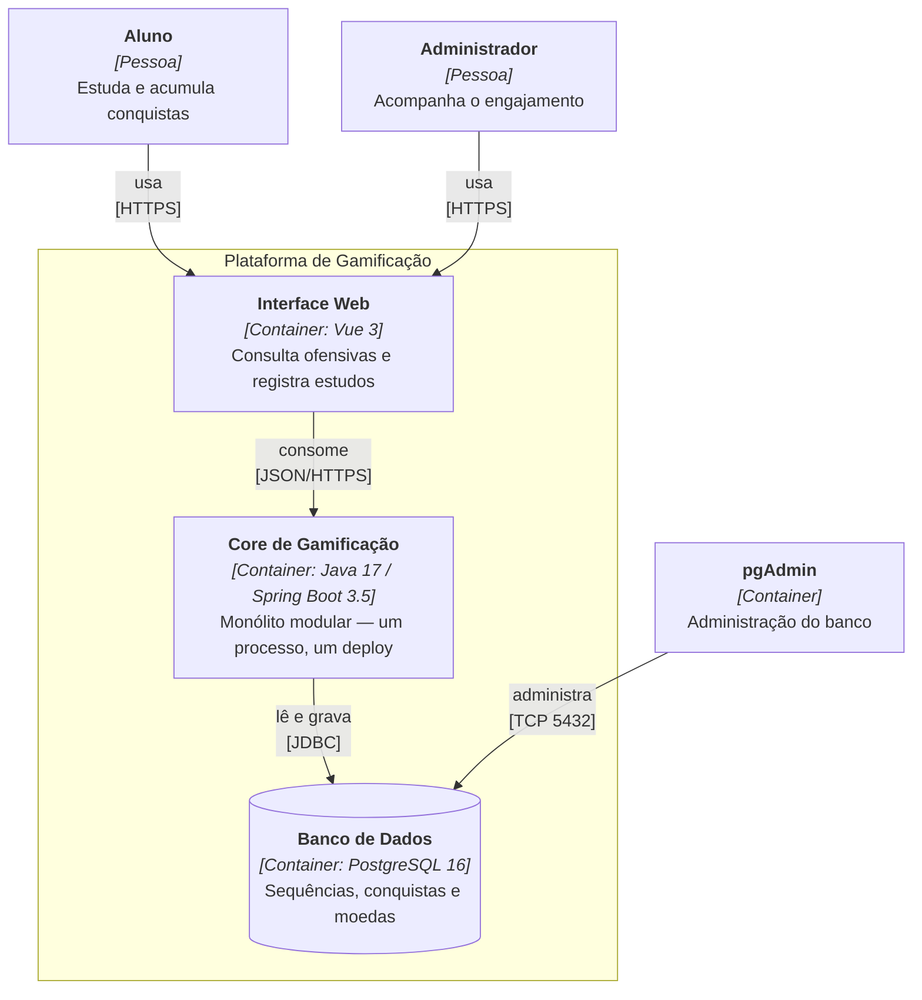
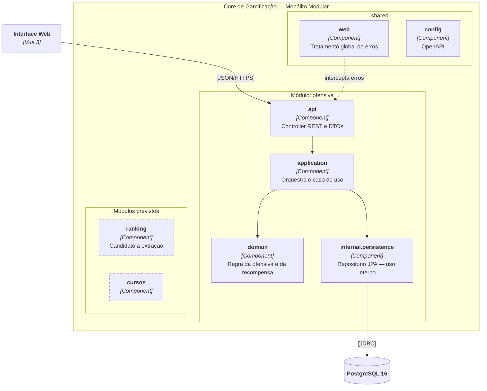

# Registro Arquitetural — Case A: Gamificação para Educação Continuada

Registro cumulativo das decisões do Architecture Lab (B1). Cada desafio acrescenta uma linha à
matriz de ASRs, um ADR e a visão C4 afetada.

**Equipe (3 integrantes):** Yuri Peruzzo · Enzo Zorzetto · Pedro Ricci Gomes Nascimento

| Desafio | Tema | ADR | Status |
|---|---|---|---|
| 1 | Drivers e evolução do Core | [ADR-001](#adr-001--evoluir-o-core-para-monólito-modular) | ✅ Concluído |
| 2 | Organização interna do Core | — | Pendente |
| 3 | Serviço Python e IA | — | Pendente |
| 4 | Comunicação e eventos | — | Pendente |
| 5 | IoT e MQTT | — | Pendente |
| 6 | CI/CD e observabilidade | — | Pendente |

## Matriz cumulativa de ASRs

| ID | ASR | Qualidade (FURPS+) | Origem | Desafio | Decisão que o atende |
|---|---|---|---|---|---|
| ASR-01 | Regras de gamificação mudam com frequência e a mudança não pode se espalhar pelo sistema | Supportability — manutenibilidade | RF01, RF02 | 1 | ADR-001 |
| ASR-02 | Leitura de ranking cresce de forma desproporcional às demais funcionalidades | Performance — escalabilidade | RF01 | 1 | ADR-001 |
| ASR-03 | A operação precisa caber em uma equipe de 3 pessoas, sem time de plataforma | Supportability — complexidade operacional | RPC-02 | 1 | ADR-001 |

---

# DESAFIO 1 — Drivers e evolução do Core

> **Prática B1 — itens 1 a 4** (leitura da solução proposta, análise do legado e estudo
> dos dois códigos-modelo) está em [`pratica-b1.md`](pratica-b1.md), com as quatro bases
> medidas pela mesma ferramenta de dependências.

> **Cadeia de rastreabilidade:** RF → RNF → ASR + RPC → alternativas/trade-offs → ADR → C4 → evidência.
> Cada seção abaixo é um elo; o resumo fechado está em [Rastreabilidade](#9-rastreabilidade-do-desafio-1).

## 1. RF — o que o sistema precisa fazer

| ID | Requisito funcional | Situação na AC1 |
|---|---|---|
| RF01 | Ranking de alunos | Não implementado; previsto para o B1 |
| RF02 | Conquistas e recompensas por comportamento | Implementado na US1 — ofensiva de dias consecutivos, com moeda ao atingir 7 dias |
| RF-evo | Evolução contínua de cursos, moedas e badges | Em andamento |

## 2. RNF — qualidades analisadas

| RNF | FURPS+ | Por que entra na análise |
|---|---|---|
| Manutenibilidade | Supportability | As regras de gamificação são o que mais muda no produto |
| Desempenho | Performance | A consulta de ranking tende a ser a mais frequente |
| Escalabilidade | Performance | Salto projetado de 1.000 para 100.000 usuários |
| Testabilidade | Supportability | A AC1 nasceu de TDD e a cobertura precisa ser preservada |
| Complexidade operacional | Supportability | Equipe de 3 pessoas, sem time de plataforma |

## 3. ASR — seleção

Dos cinco RNFs acima, **três** dirigem esta decisão.

| ASR | RNF | Como altera a arquitetura |
|---|---|---|
| **ASR-01** | Manutenibilidade | Altera a **estrutura**: exige fronteiras explícitas por capacidade de negócio, para que uma mudança em conquistas não force tocar ranking, cursos e recompensas. |
| **ASR-02** | Escalabilidade | Altera a **implantação** futura: o ranking cresce em leitura mais rápido que o resto, então a parte que escala precisa ser isolável sem reescrever o produto. |
| **ASR-03** | Complexidade operacional | Altera a **operação**: com 3 pessoas e sem esteira madura, cada artefato independente a mais transfere esforço de produto para infraestrutura. |

### RNFs que não viraram ASR

- **Desempenho** — o gargalo previsto é a leitura do ranking, tratável com índice, projeção de
  leitura ou cache dentro de um único artefato. Não muda estrutura, comunicação, dados nem
  implantação agora; vira ASR se a medição do Desafio 6 mostrar que a leitura compete por recurso
  com a escrita.
- **Testabilidade** — já atendida pelo ciclo TDD da AC1 (25 testes, cobertura 100%). É critério de
  não regressão da decisão, não driver dela.

## 4. RPC — restrições e premissas

| ID | Restrição / premissa | Efeito no espaço de decisão |
|---|---|---|
| RPC-01 | Core permanece em Java 17 / Spring Boot | Elimina reescrita de plataforma; a decisão é sobre organização, não sobre linguagem |
| RPC-02 | **Equipe de 3 desenvolvedores** | Limita quantos artefatos independentes podem ser operados com segurança |
| RPC-03 | Banco relacional único (PostgreSQL), herdado da AC1 | Separar serviços exigiria separar dados — custo não previsto nesta etapa |
| RPC-04 | Legado funcional da AC1 em operação | A evolução precisa ser incremental, sem parar a entrega |
| RPC-05 | Contratos REST existentes devem continuar válidos | A reorganização não pode quebrar os endpoints já publicados |

> O cenário do exercício cita uma equipe de 6 desenvolvedores. A equipe real deste projeto tem **3**.
> A restrição é, portanto, mais rígida do que a do enunciado — o que reforça a decisão em vez de
> enfraquecê-la: menos pessoas disponíveis tornam a complexidade distribuída ainda menos sustentável.

## 5. Decisão do Tech Lead

**Quais RNFs tornam-se ASRs?** Manutenibilidade, escalabilidade e complexidade operacional
(ASR-01 a ASR-03). Desempenho e testabilidade ficam fora pelos motivos da seção 3.

**Há necessidade comprovada de escala ou deploy independente?** Não. O crescimento do ranking é
**projeção, não medição**. Existe um único fluxo em produção e nenhuma métrica mostrando que a
leitura de ranking compete por recursos com o restante. Separar agora seria decidir por antecipação.

**A complexidade distribuída é justificável?** Não neste momento. Com RPC-02 (3 pessoas) e RPC-03
(banco único), a decomposição traria rede, consistência distribuída, versionamento de contratos e
observabilidade por serviço — custos reais pagos contra um benefício ainda hipotético.

**Decisão:** evoluir o Core de **Monólito em Camadas** para **Monólito Modular**, mantendo processo,
artefato e banco únicos, e organizando o código por **capacidade de negócio** em vez de camada
técnica. O ranking fica registrado como primeiro candidato à extração, condicionada à medição no
Desafio 6.

## 6. Alternativas e trade-offs

| Critério | (A) Monólito em Camadas | (B) Monólito Modular | (C) Ranking como serviço |
|---|---|---|---|
| Simplicidade inicial | Alta | Média | Baixa |
| Controle de acoplamento | Médio — degrada com o crescimento | Alto — limites explícitos | Alto — limite físico |
| Manutenibilidade (ASR-01) | Tende a degradar | **Atende** | Atende |
| Escala independente (ASR-02) | Não oferece | Prepara a extração | **Oferece hoje** |
| Complexidade operacional (ASR-03) | Baixa | **Baixa** | Alta — rede, dados, observabilidade |
| Deploy | Único | Único | Independente por serviço |
| Banco de dados | Único | Único | Exigiria separação — fere RPC-03 |
| Custo para 3 desenvolvedores (RPC-02) | Baixo | Baixo/Médio | Alto |
| Risco principal | Erosão da estrutura | Disciplina de fronteiras | Overengineering |

**Trade-off aceito na opção B:** o deploy continua único, então uma falha em qualquer módulo derruba
o artefato inteiro, e não há ganho imediato de escala em runtime. Em troca, o acoplamento passa a
ser contido por fronteiras e a extração futura deixa de exigir reescrita. Aceita-se também a
disciplina estrutural: a fronteira do módulo é convenção, e só se sustenta se a equipe não a
atravessar por conveniência.

**Por que (A) foi descartada:** atende ASR-03, mas não ASR-01 nem ASR-02. Com o crescimento
previsto, a organização por camada faz qualquer mudança de regra atravessar `controller`, `service`,
`repository` e `dto`.

**Por que (C) foi descartada:** atenderia ASR-02 de imediato, mas viola ASR-03 e RPC-03, e resolve
um problema que ainda não foi observado.

---

## ADR-001 — Evoluir o Core para Monólito Modular

**Status:** Aceito · **Data:** 2026-10-08 · **Desafio:** 1

### Contexto

O MVP da AC1 foi construído para ~1.000 usuários como monólito organizado em camadas técnicas
(`controller`, `service`, `repository`, `dto`, `domain`). O produto passa a projetar 100.000
usuários, com o ranking crescendo mais que as demais funcionalidades, enquanto cursos, conquistas e
recompensas seguem evoluindo. A equipe tem 3 desenvolvedores, o Core é Java 17 / Spring Boot e o
banco relacional é único e herdado.

### ASRs e RPCs que dirigem a decisão

- **ASR-01** manutenibilidade · **ASR-02** escalabilidade do ranking · **ASR-03** complexidade
  operacional compatível com 3 pessoas
- **RPC-01** Java 17 / Spring Boot · **RPC-02** equipe de 3 · **RPC-03** banco relacional único ·
  **RPC-04** legado da AC1 em operação · **RPC-05** contratos REST preservados

### Alternativas consideradas

(A) manter Monólito em Camadas · (B) evoluir para Monólito Modular · (C) extrair o ranking como
serviço independente.

### Decisão

Adotada a alternativa **(B) Monólito Modular**. O código passa a ser organizado por capacidade de
negócio, com `ofensiva` como primeiro módulo e `shared` para o que é transversal. Cada módulo tem
subcamadas internas `api`, `application`, `domain` e `internal/persistence`, e um `package-info.java`
que declara sua responsabilidade. Processo, artefato e banco permanecem únicos.

### Consequências

**Positivas**

- O acoplamento entre partes do produto passa a ser contido dentro do módulo: a evidência mediu
  **8 dependências cruzando o primeiro nível antes e 0 depois**.
- Uma mudança nas regras de conquista fica restrita a `ofensiva/`, sem tocar o que for de ranking,
  cursos ou recompensas.
- O segmento `internal/` marca explicitamente o que não deve ser consumido de fora do módulo.
- A extração futura do ranking deixa de ser reescrita e passa a ser o recorte de uma fronteira que
  já existe.
- Custo operacional inalterado: um artefato, um pipeline, um banco.
- Contratos REST preservados (RPC-05): os endpoints não mudaram e os 25 testes seguem verdes.

**Negativas / trade-offs aceitos**

- Nenhum ganho imediato de escala ou isolamento de falha — o deploy continua único.
- A fronteira é convenção, não barreira física: depende de disciplina da equipe e de revisão de
  código para não ser atravessada.
- Exige mais desenho inicial: cada funcionalidade nova precisa ser alocada a um módulo.
- Com apenas um módulo de negócio implementado, o benefício é hoje estrutural e se confirma à
  medida que `ranking` e `cursos` forem criados.

**Dívida registrada**

A medição expôs `ofensiva.application → ofensiva.api`: a camada de aplicação depende do contrato de
saída da API. É dependência na direção errada e fica como entrada para o **Desafio 2**, que trata
justamente de qual dependência precisa ser invertida.

### Condição de revisão

Este ADR deve ser reaberto se a observabilidade do Desafio 6 demonstrar que a leitura de ranking
compete por recurso com as operações de escrita, ou se a equipe crescer a ponto de o artefato único
virar gargalo de entrega.

---

## 7. C4 — visões afetadas

### Nível 2 — Container

A decisão é interna ao Core: o número de containers não muda. O diagrama registra o estado após o
ADR-001 e serve de base para os desafios seguintes.



### Nível 3 — Component (Core de Gamificação)

É aqui que o ADR-001 aparece: os componentes deixam de ser agrupados por camada técnica e passam a
ser agrupados por capacidade de negócio.



---

## 8. Evidência — mini-lab de modularização

A funcionalidade da AC1 (ofensiva de estudos, RF02) foi reorganizada de camada técnica para
capacidade de negócio, e as dependências foram medidas antes e depois.

### Estrutura antes e depois

```text
ANTES — por camada técnica          DEPOIS — por capacidade de negócio
br.edu.gamificacaocursos/           br.edu.gamificacaocursos/
├── config/                         ├── ofensiva/
├── controller/                     │   ├── package-info.java
├── domain/                         │   ├── api/
├── dto/                            │   ├── application/
├── repository/                     │   ├── domain/
└── service/                        │   └── internal/persistence/
                                    └── shared/
                                        ├── package-info.java
                                        ├── config/
                                        └── web/
```

O segmento `internal/` segue a convenção de marcar o que é detalhe do módulo e não deve ser
consumido de fora. O `package-info.java` declara a responsabilidade de cada módulo.

### Dependências medidas

Relatórios em [`evidencias/dependencias-antes.txt`](evidencias/dependencias-antes.txt) e
[`evidencias/dependencias-depois.txt`](evidencias/dependencias-depois.txt), gerados por
[`evidencias/analisar-dependencias.py`](evidencias/analisar-dependencias.py), que conta os imports
entre pacotes do próprio projeto.

| Métrica | Antes | Depois |
|---|---|---|
| Pacotes de primeiro nível | 7 | 3 |
| Dependências entre pacotes | 8 | 5 |
| **Dependências que cruzam o primeiro nível** | **8** | **0** |

```text
ANTES                                   DEPOIS
controller -> dto           3           ofensiva.api                  -> ofensiva.application          1
controller -> service       1           ofensiva.application          -> ofensiva.api                  1
repository -> domain        1           ofensiva.application          -> ofensiva.domain               1
service    -> domain        1           ofensiva.application          -> ofensiva.internal.persistence 1
service    -> dto           1           ofensiva.internal.persistence -> ofensiva.domain               1
service    -> repository    1
```

### Leitura do resultado

Duas coisas aconteceram.

**O acoplamento foi contido.** As dependências que restaram são **todas internas** ao módulo
`ofensiva`: nenhuma cruza o primeiro nível. Antes, as 8 atravessavam pacotes técnicos — qualquer
módulo futuro precisaria se misturar aos mesmos `controller`, `service` e `repository`. Agora um
módulo novo (`ranking`, `cursos`) nasce sem tocar em nada do que existe. É isso que sustenta ASR-01
e prepara ASR-02.

**Três dependências desapareceram.** Os 3 imports `controller → dto` deixaram de existir porque os
DTOs passaram a morar no mesmo pacote `api` do controller que os usa. Não é ganho cosmético: é
coesão — o contrato de entrada e saída fica junto de quem o publica.

### Não regressão

A reorganização preservou comportamento e contratos (RPC-05):

```text
[INFO] Tests run: 2, Failures: 0, Errors: 0 -- GamificacaoCursosApplicationTest
[INFO] Tests run: 7, Failures: 0, Errors: 0 -- ofensiva.api.SequenciaDeEstudosRestControllerTest
[INFO] Tests run: 8, Failures: 0, Errors: 0 -- ofensiva.application.SequenciaDeEstudosServiceTest
[INFO] Tests run: 5, Failures: 0, Errors: 0 -- ofensiva.domain.SequenciaDeEstudosTest
[INFO] Tests run: 3, Failures: 0, Errors: 0 -- ofensiva.acceptance.RunCucumberTest
[INFO]
[INFO] Tests run: 25, Failures: 0, Errors: 0, Skipped: 0
[INFO] BUILD SUCCESS
```

Cobertura JaCoCo após a reorganização: **100%**. Os endpoints seguem em `/api/sequencias`.

### Como reproduzir

```bash
mvn clean test
python docs/arquitetura/evidencias/analisar-dependencias.py src/main/java/br/edu/gamificacaocursos "DEPOIS"
```

---

## 9. Rastreabilidade do Desafio 1

| Elo | Conteúdo | Onde |
|---|---|---|
| **RF** | RF01 Ranking · RF02 Conquistas | [§1](#1-rf--o-que-o-sistema-precisa-fazer) |
| **RNF** | Manutenibilidade, desempenho, escalabilidade, testabilidade, complexidade operacional | [§2](#2-rnf--qualidades-analisadas) |
| **ASR** | ASR-01, ASR-02, ASR-03 — desempenho e testabilidade descartados com justificativa | [§3](#3-asr--seleção) |
| **RPC** | RPC-01 a RPC-05 — equipe de 3, banco único, Java/Spring, legado, contratos | [§4](#4-rpc--restrições-e-premissas) |
| **Alternativas** | (A) Camadas · (B) Modular · (C) Serviço — com trade-offs | [§6](#6-alternativas-e-trade-offs) |
| **ADR** | ADR-001 — Monólito Modular | [ADR-001](#adr-001--evoluir-o-core-para-monólito-modular) |
| **C4** | Container (sem mudança) + Component (reorganizado) | [§7](#7-c4--visões-afetadas) |
| **Evidência** | 8 → 0 dependências cruzando o topo, 25 testes verdes | [§8](#8-evidência--mini-lab-de-modularização) |

```text
RF01 Ranking ─────────┐
RF02 Conquistas ──────┤
                      ▼
      RNF: manutenibilidade · desempenho · escalabilidade ·
           testabilidade · complexidade operacional
                      ▼
      ASR-01 + ASR-02 + ASR-03      (desempenho e testabilidade descartados)
                      +
      RPC-01 Java/Spring · RPC-02 equipe de 3 · RPC-03 banco único ·
      RPC-04 legado da AC1 · RPC-05 contratos REST
                      ▼
      Alternativas A / B / C   →   trade-offs
                      ▼
      ADR-001: Monólito Modular
                      ▼
      C4 Container (inalterado) + C4 Component (por capacidade)
                      ▼
      Evidência: 8 → 0 dependências cruzando o topo, com 25 testes verdes
```
